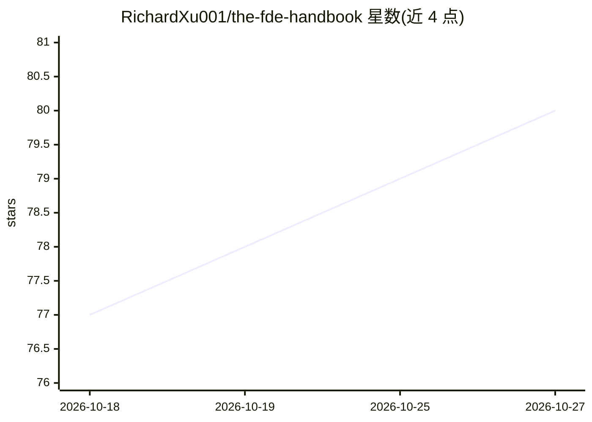

# RichardXu001/the-fde-handbook

⭐ 80 · NOASSERTION · 推送 2026-09-10 · [GitHub](https://github.com/RichardXu001/the-fde-handbook) · [官网](https://0to1.site) · 个人维护 · 中文 README

**面向前线部署工程师（FDE）的企业 AI 落地中文开源手册**

一本免费公开阅读的开源电子书，作者许良（AI 领域创业者）。全书六部 28 章，系统化介绍前线部署工程师（Forward Deployed Engineer）的角色边界、从需求发现到生产上线的交付方法、数据权限/Agent 约束/评测/成本等工程底座、采用与移交、商业收费模式与团队建设。案例来自作者交付经历、亲历者脱敏讲述与公开材料，引用来源在附录 C 标注。提供中英文版与 PDF 全书下载，采用自定义许可（禁止商业用途，需署名），商业授权需联系作者。

## 筛选速览

| 维度 | 判定 | 备注 |
|---|---|---|
| AI 角色 | `ai-knowledge` | 知识聚合/清单类 |
| 许可风险 | `none` | NOASSERTION |
| 部署形态 | `None` |  |
| 模型依赖 | — | README 未给出锁定关系 |
| 硬件要求 | — | 无带数字的原话,不猜 |
| 安装摩擦 | `low` | 无编译、无系统依赖或容器化 |
| 成熟度 | — | 结构信号不足 |

## 能力要点

- 六部 28 章覆盖 FDE 角色边界、交付方法、工程底座、采用移交、商业模式与团队建设
- 提供中文版、英文版（en/ 目录）与 PDF 全书下载
- 附录含 FDE 交付检查清单、术语表与来源引用说明
- 自定义许可：允许个人学习与非商业分享，禁止商业用途，使用需署名

## 适用场景

- 工程师或技术负责人了解 FDE 职能并学习企业 AI 落地方法
- 甲方按第二、四部判断项目上线时机与移交方案
- 创业者按第五部了解这门生意的收费与产品化逻辑

## 场景标签

`教程课程` · 领域:学习与行业

## 证据(README 行号)

> L3: 《FDE：企业 AI 落地实战手册》——前线部署工程师（前沿部署工程师 · Forward Deployed Engineer · FDE）的企业 AI 落地实战开源手册
> L13: **FDE**，全称 Forward Deployed Engineer，中文一般译作**前线部署工程师**或**前沿部署工程师**，是 2025 年起在硅谷走红、随后在国内大厂与 AI 创业公司蔓延的新型岗位：把 AI 工程师直

## 星数曲线

2026-10-18 77 → 2026-10-27 80（+3）

---
*卡片 v1 · prompt 1.4 · 生成 2026-10-24 · 置信度 high · 依据 README sha `14a5027bc063` · [字段定义](../../DATASET.md)*
