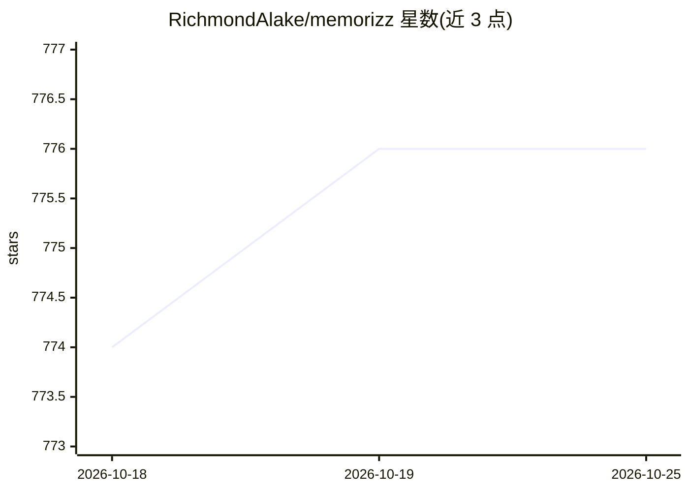

# RichmondAlake/memorizz

⭐ 777 · Python · NOASSERTION · 推送 2026-10-25 · [GitHub](https://github.com/RichmondAlake/memorizz) · [官网](https://github.com/RichmondAlake/memorizz) · 个人维护

**为 AI agent 提供持久记忆层的 Python 框架**

Python 框架，为 agent 提供记忆管理与构建能力：支持情景/语义/程序性/短期/共享五类记忆，可按 agent、用户、会话隔离；存储支持本地文件系统、MongoDB、Oracle、Notion，并配独立向量存储。提供 MemAgent 构建器、CLI、本地 Web UI 与 MCP server 界面；MetaHarness 可通过 Codex、Claude Code、DeepSeek 等运行任务。包含基于 Generative Agents 的可逆遗忘机制与可选的持续学习/微调环。需 Python 3.10+，默认使用云模型 API key，也有 Ollama 本地方案。许可为 PolyForm Noncommercial 1.0.0（非商用）。

## 筛选速览

| 维度 | 判定 | 备注 |
|---|---|---|
| AI 角色 | `ai-ecosystem` | LLM/agent 周边工具 |
| 许可风险 | `none` | NOASSERTION |
| 部署形态 | `library` | 以包/库形式分发 |
| 模型依赖 | local-ok | 支持本地模型 |
| 硬件要求 | — | 无带数字的原话,不猜 |
| 安装摩擦 | `low` | 无编译、无系统依赖或容器化 |
| 成熟度 | — | 结构信号不足 |

## 能力要点

- 五类记忆（情景/语义/程序性/短期/共享）与按 agent/用户/会话隔离
- 多存储后端：本地文件系统、MongoDB、Oracle、Notion 及独立向量存储
- 可作为 Codex 与 Claude Code 的记忆插件，多个 agent 共享记忆
- MetaHarness 在 Codex、Claude Code、OpenHands、DeepSeek 等运行器上执行任务

## 适用场景

- 为自研 agent 添加跨会话持久记忆
- 让 Codex 和 Claude Code 共享同一项目的记忆
- 把文件和文件夹做成可语义检索的知识库
- 通过本地 UI 观察各 agent 的运行与 token 花费

## 场景标签

`Agent 记忆` `语义搜索` · 领域:Agent 开发

## 证据(README 行号)

> L5: Memorizz is a Python framework that connects persistent memory, models, prompts,
> L33: - **Persist and isolate:** scope memory by agent, user, and conversation. Start
> L53: Build persistent agents with `MemAgent` and `MemAgentBuilder`. Choose

## 星数曲线

2026-10-18 774 → 2026-10-25 776（+2）

---
*卡片 v1 · prompt 1.4 · 生成 2026-10-21 · 置信度 high · 依据 README sha `59e87e2fd841` · [字段定义](../../DATASET.md)*
