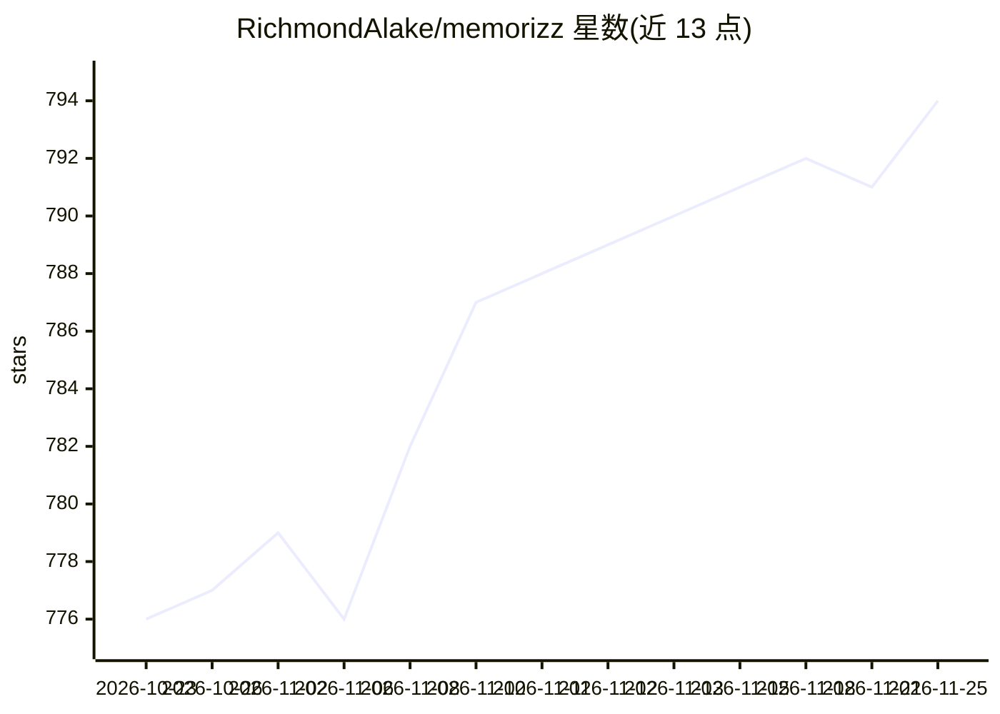

# RichmondAlake/memorizz

⭐ 794 · Python · NOASSERTION · 推送 2026-11-16 · [GitHub](https://github.com/RichmondAlake/memorizz) · [官网](https://github.com/RichmondAlake/memorizz) · 个人维护

**为 AI 应用与 agent 提供持久化记忆层的 Python 框架**

Memorizz 是 Python 框架，将持久记忆、模型、提示与推理连接起来，使 agent 能跨会话保留与召回信息。记忆按情景、语义、程序性、短期、共享五类组织，支持按 agent/用户/会话隔离，默认本地文件系统存储，也可接 MongoDB、Oracle 或 Notion 加独立向量存储。通过 MemAgent/MemAgentBuilder 构建 agent，支持 MCP 工具、persona、多 agent 协作，并可运行于 Codex、Claude Code 等外部 harness。可选持续学习循环将成功的工具流程蒸馏为可复用技能，并对记忆用的小模型做微调。需 Python 3.10+，源代码以 PolyForm Noncommercial 1.0.0 许可提供。

## 筛选速览

| 维度 | 判定 | 备注 |
|---|---|---|
| AI 角色 | `ai-ecosystem` | LLM/agent 周边工具 |
| 许可风险 | `none` | NOASSERTION |
| 部署形态 | `library` | 以包/库形式分发 |
| 模型依赖 | local-ok | 支持本地模型 |
| 硬件要求 | — | 无带数字的原话,不猜 |
| 安装摩擦 | `low` | 无编译、无系统依赖或容器化 |
| 成熟度 | — | 结构信号不足 |

## 能力要点

- 五类记忆（情景/语义/程序性/短期/共享）与按 agent/用户/会话隔离
- 支持 MongoDB、Oracle、Notion 等存储提供方及语义/混合检索
- 作为 Codex 与 Claude Code 的插件提供跨会话项目记忆
- opt-in 持续学习循环：工具流程蒸馏为技能、记忆小模型微调

## 适用场景

- 为跨会话运行的 agent 添加持久记忆与上下文管理
- 让 Codex/Claude Code 编码会话共享项目事实与历史摘要
- 在本地文件系统或 MongoDB/Oracle 上搭建 agent 知识库
- 通过治理式遗忘与保留控制管理长期记忆

## 场景标签

`Agent 记忆` `多智能体` · 领域:Agent 开发

## 证据(README 行号)

> L5: Memorizz is a Python framework that connects persistent memory, models, prompts,
> L71: - **Interfaces:** use the Python SDK, interactive CLI, local web UI, or expose
> L99: MemoRizz is also a plugin for Codex and Claude Code. The agent starts each

## 星数曲线

2026-10-23 776 → 2026-11-25 794（+18）

---
*卡片 v1 · prompt 1.4 · 生成 2026-11-25 · 置信度 high · 依据 README sha `194ed96f289e` · [字段定义](../../DATASET.md)*
