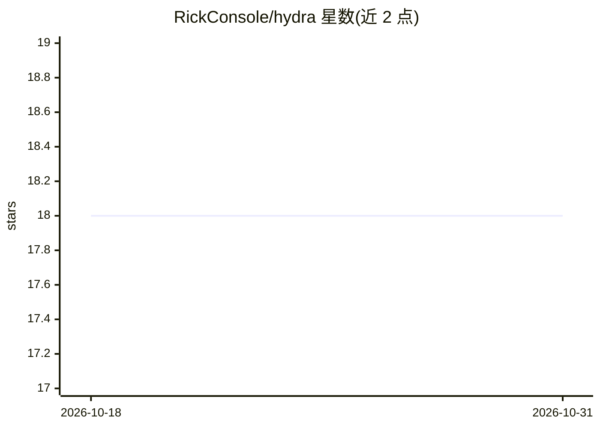

# RickConsole/hydra

⭐ 18 · TypeScript · MIT · 推送 2026-02-23 · [GitHub](https://github.com/RickConsole/hydra) · 个人维护

**容器隔离的多 agent 编排系统：单配置文件管理 Claude Code agent**

多 agent AI 编排框架，每个 agent 运行在独立容器中，Bash 命令在临时容器内执行而非宿主机，文件访问仅限显式挂载路径。基于 Claude Agent SDK（Claude Code）作为运行时，通过单个 hydra.yaml 配置 agent 的挂载、工具、MCP 服务器与密钥，提供 CLI 交互与 Telegram 多模态通道。持久记忆采用 mem0（自托管或云），配合 Qdrant 与 Ollama embedding。要求 Node.js 20+ 与 Docker，需 Anthropic API key 或 Claude Code OAuth。

## 筛选速览

| 维度 | 判定 | 备注 |
|---|---|---|
| AI 角色 | `ai-ecosystem` | LLM/agent 周边工具 |
| 许可风险 | `permissive` | MIT |
| 部署形态 | `self-host` | docker 或自建部署 |
| 模型依赖 | local-ok | 支持本地模型 |
| 硬件要求 | — | 无带数字的原话,不猜 |
| 安装摩擦 | `low` | 无编译、无系统依赖或容器化 |
| 成熟度 | — | 结构信号不足 |

## 能力要点

- 每个 agent 独立容器隔离，OS 级安全（IPC 命名空间、只读挂载）
- 双文件挂载模型：hydra.yaml 与外部 mount-allowlist.json 须同时批准
- 单文件 hydra.yaml 配置 agent、密钥注入与计划任务
- mem0 持久向量记忆（Qdrant + Ollama embedding），支持 Telegram 多模态

## 适用场景

- 在隔离环境中运行多个 Claude Code agent 处理不同任务
- 通过 Telegram 与 agent 进行多模态交互
- 需要严格控制 agent 文件访问与密钥权限的场景

## 场景标签

`Agent 框架` `多智能体` `编码 Agent` · 领域:Agent 开发

## 证据(README 行号)

> L18: **Hydra agents run in containers.** Each agent is isolated at the OS level. They can only see what you explicitly m
> L36: |**Runtime**|Claude API wrapper|Claude Agent SDK (Claude Code)|
> L40: 1. **Create your agents** via the Hydra CLI or `hydra.yaml`

## 星数曲线

2026-10-18 18 → 2026-10-31 18（+0）

---
*卡片 v1 · prompt 1.4 · 生成 2026-10-29 · 置信度 mid · 依据 README sha `37ce29289904` · [字段定义](../../DATASET.md)*
