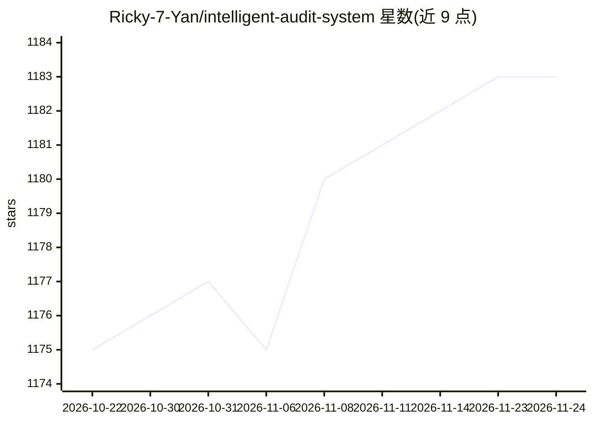

# Ricky-7-Yan/intelligent-audit-system

⭐ 1,183 · Python · MIT · 推送 2026-11-05 · [GitHub](https://github.com/Ricky-7-Yan/intelligent-audit-system) · 个人维护 · 中文 README

**给审计师的证据可溯源 Agent 审计交付工作台**

面向企业审计交付场景的 Web 工作台，将证据检索、控制测试、人工复核与整改闭环组织为可追溯流程。Agent Runtime 提供有界 Plan/Execute/Reflect 循环与人工复核出口；RAG 采用 TF-IDF+关键词混合检索，语义向量为可选增强；内置评测 Harness 分层评测并设发布门禁；工具调用经 RBAC 校验并有调用日志。默认支持无模型密钥的确定性回退运行，LLM 配置可选。

## 筛选速览

| 维度 | 判定 | 备注 |
|---|---|---|
| AI 角色 | `ai-native` | 本体是模型或模型工具 |
| 许可风险 | `permissive` | MIT |
| 部署形态 | `desktop` | 安装包/桌面程序 |
| 模型依赖 | — | README 未给出锁定关系 |
| 硬件要求 | — | 无带数字的原话,不猜 |
| 安装摩擦 | `low` | 无编译、无系统依赖或容器化 |
| 成熟度 | `idea` | |

## 能力要点

- 6 个内置审计模板：4 类标准、34 控制主题、25 类交付物
- 页段级来源引用、证据缺口提示与人工复核出口
- 分层评测 Harness，关键断言失败阻断发布
- 外发公开搜索需部署开关+独立权限+敏感信息检查三重条件

## 适用场景

- 为 SOX ITGC、ERP 权限等场景生成证据请求单与控制矩阵
- 对审计 Agent 的任务结果与执行轨迹做分层评测和回归
- 管理审计发现、整改责任人与到期日的闭环交付

## 场景标签

`RAG` `模型评测` · 领域:评测与运维

## 证据(README 行号)

> L5:  面向审计交付场景的企业级 AI Agent 工作台：把证据检索、工具执行、Harness 评测、人工复核与整改闭环放进同一条可追溯工作流。
> L53: |Agent Runtime|有界 Plan / Execute / Reflect 循环、按任务自适应规划、步骤依赖、结构化交接、独立交付校验、失败恢复和人工复核出口。|
> L57: |Evaluation Harness|对任务结果、执行轨迹、工具调用、证据依据、安全权限、上下文和鲁棒性分层评测；输出校准得分与置信下界，关键断言失败直接阻断发布。|

## 星数曲线

2026-10-22 1,175 → 2026-11-24 1,183（+8）

---
*卡片 v1 · prompt 1.4 · 生成 2026-11-23 · 置信度 high · 依据 README sha `5868b2e91317` · [字段定义](../../DATASET.md)*
