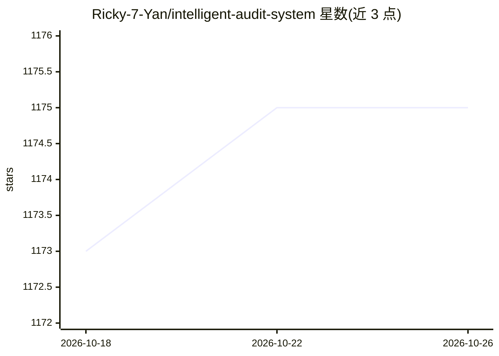

# Ricky-7-Yan/intelligent-audit-system

⭐ 1,175 · Python · 推送 2026-08-12 · [GitHub](https://github.com/Ricky-7-Yan/intelligent-audit-system) · 个人维护 · 中文 README

**面向企业审计交付的 AI Agent 工作台，证据检索到整改闭环**

面向审计交付场景的 Python/FastAPI Web 应用：将审计立项、控制矩阵、Agentic RAG 证据检索、有界 Agent 运行时（Plan/Execute/Reflect）、分层评测 Harness、人工复核与整改任务组织在同一条可追溯工作流，内置 6 个审计模板（SOX ITGC、ERP SoD、数据安全等）。默认支持无模型密钥的确定性回退模式，可配置 DeepSeek 等兼容提供商做 LLM 增强；语义向量、MySQL、Neo4j 均为可选组件。存储基于租户隔离的 SQLite WAL。

## 筛选速览

| 维度 | 判定 | 备注 |
|---|---|---|
| AI 角色 | `ai-native` | 本体是模型或模型工具 |
| 许可风险 | `none` | — |
| 部署形态 | `desktop` | 安装包/桌面程序 |
| 模型依赖 | — | README 未给出锁定关系 |
| 硬件要求 | — | 无带数字的原话,不猜 |
| 安装摩擦 | `low` | 无编译、无系统依赖或容器化 |
| 成熟度 | — | 结构信号不足 |

## 能力要点

- 有界 Plan/Execute/Reflect Agent 循环，含失败恢复与人工复核出口
- TF-IDF + 关键词多路召回的 Agentic RAG，语义向量为可选增强
- 分层评测 Harness 输出校准得分与置信下界，关键断言失败阻断发布
- 默认无模型密钥可运行，进入确定性回退模式

## 适用场景

- 在审计项目中组织证据检索、控制测试与整改闭环
- 对 Agent 任务结果与执行轨迹做分层评测与发布门禁
- 通过 MCP 式受治理工具与 RBAC 权限控制执行审计动作

## 场景标签

`RAG` `模型评测` · 领域:评测与运维

## 证据(README 行号)

> L5:  面向审计交付场景的企业级 AI Agent 工作台：把证据检索、工具执行、Harness 评测、人工复核与整改闭环放进同一条可追溯工作流。
> L52: |Agent Runtime|有界 Plan / Execute / Reflect 循环、按任务自适应规划、步骤依赖、结构化交接、独立交付校验、失败恢复和人工复核出口。|
> L91: 要求 Python 3.10 或更高版本。项目默认支持无模型密钥运行：未配置大模型时会进入确定性回退模式，审计工作流、RAG、评测和界面仍可体验。

## 星数曲线

2026-10-18 1,173 → 2026-10-26 1,175（+2）

---
*卡片 v1 · prompt 1.4 · 生成 2026-10-21 · 置信度 mid · 依据 README sha `2057bfe9d0a7` · [字段定义](../../DATASET.md)*
