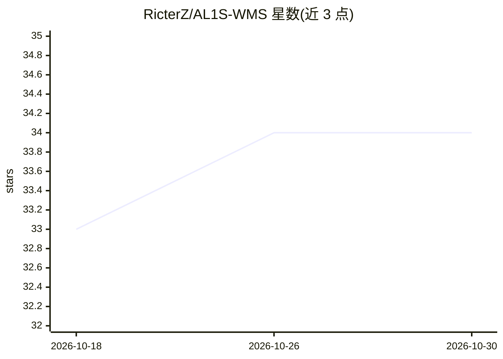

# RicterZ/AL1S-WMS

⭐ 34 · TypeScript · GPL-3.0 · 推送 2026-10-29 · [GitHub](https://github.com/RicterZ/AL1S-WMS) · 个人维护 · 中文 README

**家庭自托管库存管理系统，带 MCP 接口供 AI agent 协助**

面向家庭场景的轻量级仓库/库存管理 Web 应用：以批次为核心管理食品、药品、日用品等消耗品的收货、领用、转移、盘点与 FEFO 效期出库；采购计划、实际支出、预算与库存估值共用同一条数据链路；支持多家庭数据隔离。内置 MCP 接口（Streamable HTTP + 作用域 token），让 AI agent 在授权范围内查询库存、效期与财务并代为执行操作，重大操作需确认、库存写入用幂等键。不面向商业仓储/专业财务场景。通过 Docker Compose 部署，SQLite 存储，可接入 Home Assistant。

## 筛选速览

| 维度 | 判定 | 备注 |
|---|---|---|
| AI 角色 | `ai-enhanced` | 去掉 AI 部分产品仍成立 |
| 许可风险 | `viral` | GPL-3.0 |
| 部署形态 | `self-host` | docker 或自建部署 |
| 模型依赖 | — | README 未给出锁定关系 |
| 硬件要求 | — | 无带数字的原话,不猜 |
| 安装摩擦 | `low` | 无编译、无系统依赖或容器化 |
| 成熟度 | — | 结构信号不足 |

## 能力要点

- 批次化库存模型与完整交易历史（收货/领用/转移/盘点）
- 库存、采购与家庭预算（含分类预算、支出预测）数据联动
- MCP 接口暴露库存/采购/财务能力，token 可限定家庭作用域，写入带幂等键
- Home Assistant HACS 自定义集成，提供库存提醒与在用物品卡片

## 适用场景

- 家庭统一管理食品、药品、日用品的库存、效期与存放位置
- 把采购计划、实际花费和月度预算连在一起，替代分散的表格
- 让 AI agent 帮忙查库存、提补货建议，关键操作仍由我确认

## 场景标签

 · 领域:家庭管理/库存与财务

## 证据(README 行号)

> L5: AL1S WMS is a lightweight, self-hosted warehouse manager for the home.
> L17: Stocktaking, purchasing, and finance share one data trail. Receiving a purchase creates a stock batch and transacti

## 星数曲线

2026-10-18 33 → 2026-10-30 34（+1）

---
*卡片 v1 · prompt 1.4 · 生成 2026-10-25 · 置信度 mid · 依据 README sha `4d30913edb57` · [字段定义](../../DATASET.md)*
