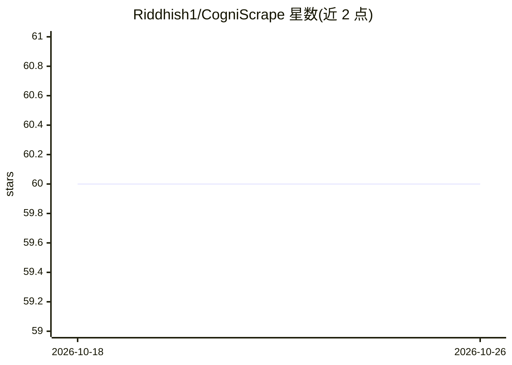

# Riddhish1/CogniScrape

⭐ 60 · TypeScript · MIT · 推送 2026-01-05 · [GitHub](https://github.com/Riddhish1/CogniScrape) · 个人维护

**TypeScript LLM 智能网页抓取库：结构化提取数据**

面向 TypeScript 开发者的网页抓取库，将传统爬取与 LLM 结合做结构化数据提取。提供 6 种 Graph 流水线（单 URL、多 URL、搜索、深度分析、CSV/JSON 导出），由 FetchNode、ParseNode、GenerateAnswerNode、RAGNode 等节点组成可组合管道。LLM 后端支持 Ollama（本地）与 Google Gemini（云端），集成 Zod 做输出校验、Playwright 处理动态内容，内置缓存、重试、限速与代理轮换。npm 安装。

## 筛选速览

| 维度 | 判定 | 备注 |
|---|---|---|
| AI 角色 | `ai-ecosystem` | LLM/agent 周边工具 |
| 许可风险 | `permissive` | MIT |
| 部署形态 | `library` | 以包/库形式分发 |
| 模型依赖 | local-ok | 支持本地模型 |
| 硬件要求 | — | 无带数字的原话,不猜 |
| 安装摩擦 | `low` | 无编译、无系统依赖或容器化 |
| 成熟度 | — | 结构信号不足 |

## 能力要点

- 6 种 Graph 流水线覆盖单/多 URL、搜索、深度分析与 CSV/JSON 导出
- Ollama（本地）与 Google Gemini 双 LLM 后端
- 内置缓存、重试、限速、代理轮换
- Zod 模式校验与 Playwright 浏览器自动化、RAG 节点

## 适用场景

- 用自然语言从网页提取结构化数据并校验输出
- 批量抓取多个来源并导出 CSV/JSON
- 本地 Ollama 模型零成本跑数据提取

## 场景标签

`网页抓取` · 领域:效率与自动化

## 证据(README 行号)

> L6: **Intelligent Web Scraping with LLMs** - A TypeScript library that combines traditional web scraping with Large Lang
> L11: - 📊 **Graph-Based Architecture**: Composable, reusable node pipelines

## 星数曲线

2026-10-18 60 → 2026-10-26 60（+0）

---
*卡片 v1 · prompt 1.4 · 生成 2026-10-24 · 置信度 high · 依据 README sha `f5e1723423f0` · [字段定义](../../DATASET.md)*
