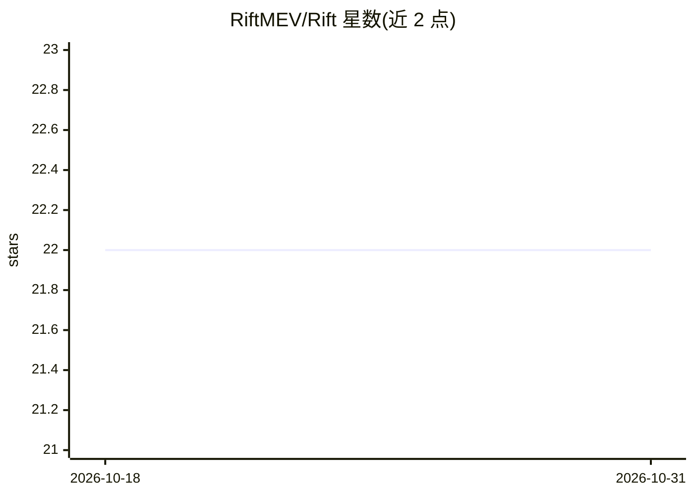

# RiftMEV/Rift

⭐ 22 · TypeScript · 推送 2026-06-22 · [GitHub](https://github.com/RiftMEV/Rift) · 个人维护

**扫描 Solana 可见 MEV 机会并输出排序机会板的雷达工具**

面向 Solana 公开 MEV 面的扫描器：监视 Jupiter 路由错位与清算关联事件，估算扣除费用、滑点与时延后的净边际，过滤失效价差，对候选机会给出 act/watch/skip 判定并输出排序机会板。README 声明使用 Claude Agent SDK 构建，覆盖 route_dislocation、liquidation_follow_through 与 fast window 三类机会。明确不保证机会可捕获，定位为排序系统；无安装包，需 git clone 后以 Bun 从源码运行。

## 筛选速览

| 维度 | 判定 | 备注 |
|---|---|---|
| AI 角色 | `ai-enhanced` | 去掉 AI 部分产品仍成立 |
| 许可风险 | `none` | — |
| 部署形态 | `None` |  |
| 模型依赖 | — | README 未给出锁定关系 |
| 硬件要求 | — | 无带数字的原话,不猜 |
| 安装摩擦 | `low` | 无编译、无系统依赖或容器化 |
| 成熟度 | — | 结构信号不足 |

## 能力要点

- 监视 Jupiter 路由错位与清算关联事件两类机会面
- 净边际过滤：扣除费用、滑点与时延后再判定
- 对机会输出 act/watch/skip 确定性判定与排序机会板
- 声明使用 Claude Agent SDK 构建

## 适用场景

- 我想在 Solana 上找扣掉执行成本后仍存活的可见价差
- 我想按优先级查看当前仍活跃的 MEV 类机会而不是原始行情快照
- 我想跟踪清算事件引发的次级机会

## 场景标签

`金融量化` · 领域:学习与行业

## 证据(README 行号)

> L3: **MEV opportunity radar for Solana.**
> L8: Built with Claude Agent SDK

## 星数曲线

2026-10-18 22 → 2026-10-31 22（+0）

---
*卡片 v1 · prompt 1.4 · 生成 2026-10-27 · 置信度 mid · 依据 README sha `a52268bacdb7` · [字段定义](../../DATASET.md)*
