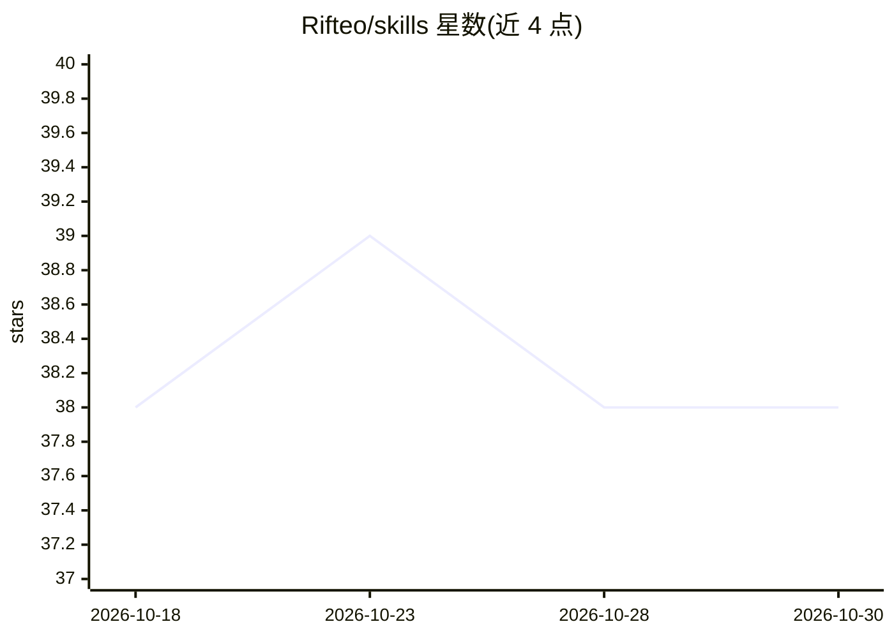

# Rifteo/skills

⭐ 38 · Python · MIT · 推送 2026-09-16 · [GitHub](https://github.com/Rifteo/skills) · 组织维护

**面向安全测试/审计/合规的 AI agent 技能库（28 技能，53 agents）**

Rifteo 维护的 agent 技能库：以方法论文件形式向 AI agent 注入渗透测试、侦察、报告与合规工作流，覆盖 XSS/XXE/IDOR/SSRF/JWT 等检测方法论及 CVSS 评分、ISO 27001/SOC2 控制映射等。通过 npm CLI（rifteo-skills add）一条命令将技能安装到 Claude Code、Gemini CLI、Codex、Cursor 等 53 个 agent，自动检测已装 agent 并放置到对应位置；为 Claude Code 额外提供 6 个斜杠命令。README 附带 19 个技能的对比基准数据（token 消耗、耗时、发现数）。

## 筛选速览

| 维度 | 判定 | 备注 |
|---|---|---|
| AI 角色 | `ai-knowledge` | 知识聚合/清单类 |
| 许可风险 | `permissive` | MIT |
| 部署形态 | `library` | 以包/库形式分发 |
| 模型依赖 | — | README 未给出锁定关系 |
| 硬件要求 | — | 无带数字的原话,不猜 |
| 安装摩擦 | `low` | 无编译、无系统依赖或容器化 |
| 成熟度 | — | 结构信号不足 |

## 能力要点

- 28 个安全技能覆盖 Web/API/基础设施/侦察/报告/合规/工作流
- 一条命令安装到 53 个已检测的 agent
- Claude Code 专属 6 个斜杠命令（triage/hunt/report 等）
- 19 个技能附 with/without 基准数据（BENCHMARK.md）

## 适用场景

- 给参与渗透测试的 AI agent 注入系统化测试方法论
- 把原始发现整理为可提交的 bug bounty 报告
- 对照 ISO 27001/SOC2/NIST/PCI-DSS 做合规差距分析

## 场景标签

`网络安全` `提示工程` · 领域:Agent 开发

## 证据(README 行号)

> L6: Install proven pentest methodologies into Claude Code, Gemini CLI, Codex, and 50+ other agents in one command.
> L22: A skill is a battle-tested methodology file your agent reads before starting a task. It covers every test case, eve
> L31: 28 skills. 53 agents. One command to install.

## 星数曲线

2026-10-18 38 → 2026-10-30 38（+0）

---
*卡片 v1 · prompt 1.4 · 生成 2026-10-25 · 置信度 high · 依据 README sha `f2fd60bd01b9` · [字段定义](../../DATASET.md)*
