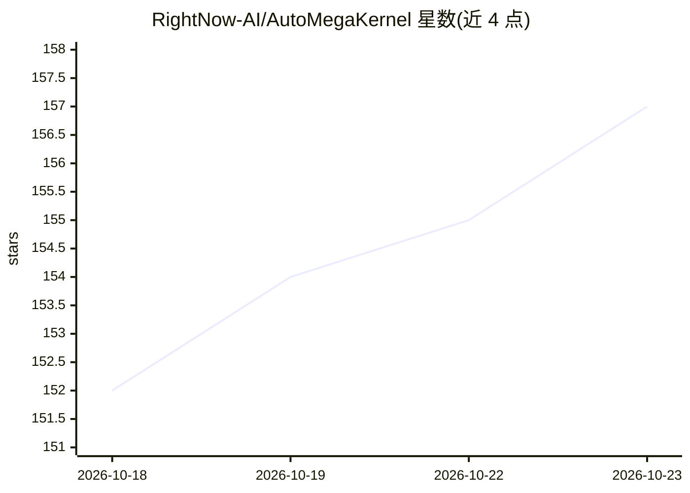

# RightNow-AI/AutoMegaKernel

⭐ 157 · Python · MIT · 推送 2026-09-18 · [GitHub](https://github.com/RightNow-AI/AutoMegaKernel) · [官网](https://runinfra.ai/) · 组织维护

**把模型编译为单次启动 CUDA megakernel 并自动调优的 agent harness**

面向 GPU 内核编译研究的 agent harness：由编码 agent（Claude Code/Codex）驱动，将 HuggingFace Llama 系列模型的前向过程融合为一次持久启动的 megakernel，先经 DAG 静态验证（死锁/竞争检查）再上 GPU，并与 eager PyTorch 逐 token 核验。内含两条自动研究循环（指令优化与调度优化），可数小时无人值守自调优；实测 int8 在推理级 GPU 上 batch-1 解码快于 cuBLAS bf16，但同精度 bf16 路径慢于 cuBLAS，README 明确声明。支持 MCP server 与 Claude Code/Codex 集成，用 uv 安装，CUDA 测试需 GPU（无 GPU 时自动跳过）。

## 筛选速览

| 维度 | 判定 | 备注 |
|---|---|---|
| AI 角色 | `ai-ecosystem` | LLM/agent 周边工具 |
| 许可风险 | `permissive` | MIT |
| 部署形态 | `library` | 以包/库形式分发 |
| 模型依赖 | locked-api |  |
| 硬件要求 | `cpu-ok` | |
| 安装摩擦 | `high` | 编译与系统依赖俱全 |
| 成熟度 | `idea` | |

## 能力要点

- 整条前向过程作为单次协作式 kernel 启动运行
- 调度先经 DAG 静态验证，无效调度在验证期被 REJECTED
- 两条 autoresearch 循环支持数小时无人值守自调优（10 分钟运行自提升 1.47×）
- 同一源码跨 sm_120/sm_80/sm_90 三架构自重定向运行

## 适用场景

- 把 Llama 系列模型编译成单 kernel 以降低 batch-1 解码延迟
- 让编码 agent 无人值守地自动优化 CUDA 内核调度
- 在多种 NVIDIA GPU 架构间复用同一模型源码重定向编译

## 场景标签

 · 领域:MLSys/GPU 内核编译

## 证据(README 行号)

> L5: > **A general agent harness for GPU megakernel synthesis.** A coding agent (Claude Code / Codex)
> L6: > drives AMK to compile a model into one **provably-correct**, self-retargeting megakernel, the
> L69: - **The whole forward pass runs as one cooperative kernel launch.** The persistent megakernel (one
> L163: AMK installs as a real package (hatchling) and exposes a real `amk` console command. `uv sync`

## 星数曲线

2026-10-18 152 → 2026-10-23 157（+5）

---
*卡片 v1 · prompt 1.4 · 生成 2026-10-22 · 置信度 high · 依据 README sha `17c630cb4e7e` · [字段定义](../../DATASET.md)*
