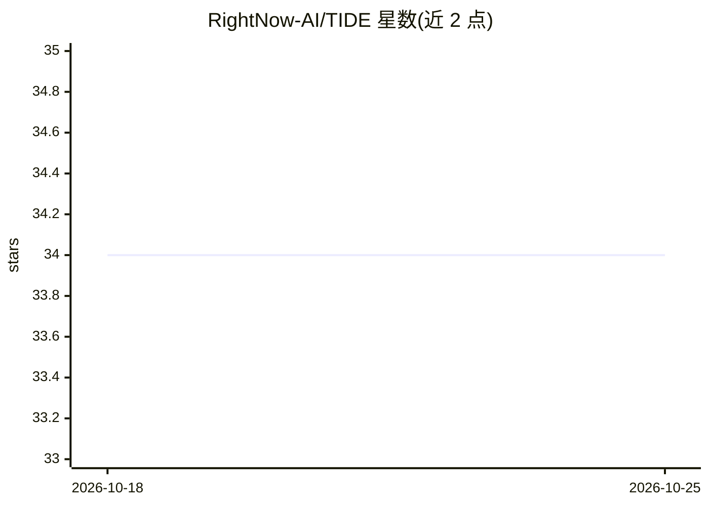

# RightNow-AI/TIDE

⭐ 34 · Python · Apache-2.0 · 推送 2026-09-18 · [GitHub](https://github.com/RightNow-AI/TIDE) · [官网](https://www.rightnowai.co/) · 组织维护

**LLM 推理逐 token 提前退出加速库：跳过 token 不需要的层**

面向 HuggingFace transformer 模型的推理加速 Python 库：通过两阶段机制（一次性校准学习每个 token 的收敛深度 + 推理时由小型 router MLP 判定提前退出），让"容易"的 token 在中间层提前输出，无需重训模型或改架构，3 行代码接入任意 AutoModelForCausalLM。提供 CUDA kernel（fp16/bf16），无 GPU 时自动回退纯 PyTorch CPU。限制：加速幅度依赖模型与任务，阈值调低会带来质量损失。

## 筛选速览

| 维度 | 判定 | 备注 |
|---|---|---|
| AI 角色 | `ai-ecosystem` | LLM/agent 周边工具 |
| 许可风险 | `permissive` | Apache-2.0 |
| 部署形态 | `library` | 以包/库形式分发 |
| 模型依赖 | — | README 未给出锁定关系 |
| 硬件要求 | — | 无带数字的原话,不猜 |
| 安装摩擦 | `medium` | 含编译或系统依赖之一 |
| 成熟度 | — | 结构信号不足 |

## 能力要点

- 两阶段机制：校准学习 token 收敛深度 + 推理时 router 提前退出
- 不改变模型权重，router MLP 仅约 0.5M 参数，无退出时开销近零
- 支持 LLaMA/DeepSeek/Qwen/Mistral/Gemma 等，其余架构自动探测
- CUDA kernel 原生支持 fp16/bf16，无 GPU 自动 CPU 回退

## 适用场景

- 给现有 HuggingFace 模型推理提速，不想重训或改架构
- 通过 exit_threshold 阈值调节质量/速度权衡
- 在仅 CPU 环境下也运行提前退出推理

## 场景标签

`推理引擎` · 领域:训练与推理

## 证据(README 行号)

> L3:  TIDE: Per-token early exit for transformer inference
> L9: Drop it onto any HuggingFace model in 3 lines.
> L70: engine = TIDE.TIDE(model, "router.pt")  # UniversalAdapter handles it

## 星数曲线

2026-10-18 34 → 2026-10-25 34（+0）

---
*卡片 v1 · prompt 1.4 · 生成 2026-10-25 · 置信度 high · 依据 README sha `c025f8d79352` · [字段定义](../../DATASET.md)*
