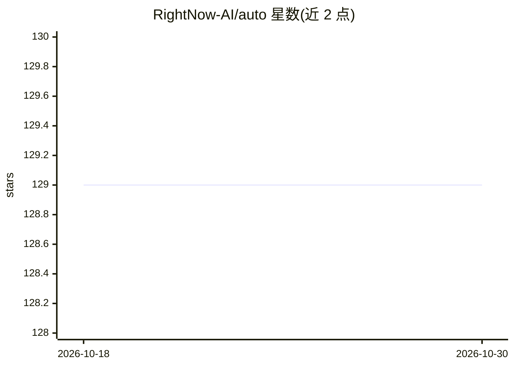

# RightNow-AI/auto

⭐ 129 · Rust · Apache-2.0 · 推送 2026-07-07 · [GitHub](https://github.com/RightNow-AI/auto) · [官网](https://runinfra.ai/) · 组织维护

**把记录的 LLM agent 行为编译为经验证的 wasm 二进制**

面向 agent 开发者的行为编译工具链：auto record 录制 agent 追踪，auto compile 将其降为类型化 IR，做符号提取、蒸馏为小模型、按行为契约验证后输出 .cbin 工件；运行时分级：tier-1 走编译快路径，守卫标记新颖输入时降级到 tier-0 前沿模型并重新编译。付费路径（LLM 引导 CEGIS、tier-0）需 OPENAI_API_KEY 与显式花费上限，默认上限 0 拒绝所有付费调用。构建需 Rust 1.96.1 与精确版本 flatc，附带 arXiv 论文与基准结果。

## 筛选速览

| 维度 | 判定 | 备注 |
|---|---|---|
| AI 角色 | `ai-ecosystem` | LLM/agent 周边工具 |
| 许可风险 | `permissive` | Apache-2.0 |
| 部署形态 | `desktop` | 安装包/桌面程序 |
| 模型依赖 | — | README 未给出锁定关系 |
| 硬件要求 | — | 无带数字的原话,不猜 |
| 安装摩擦 | `low` | 无编译、无系统依赖或容器化 |
| 成熟度 | `idea` | |

## 能力要点

- 录制→编译→验证→.cbin 工件的完整工具链（CLI/HTTP/进程内多运行形态）
- 零 wasm 导入的能力限制与契约验证门控发射
- tier-0/tier-1 分级运行时与守卫触发的去优化重编译
- 付费路径 fail-closed：需 API key 且默认花费上限为 0

## 适用场景

- 降低重复性 agent 任务的前沿模型调用成本
- 把高频 agent 行为固化为可验证的低成本二进制
- 用 OpenAI proxy 零改动录制现有 agent 流量

## 场景标签

`推理引擎` · 领域:训练与推理

## 证据(README 行号)

> L24: - The compiler: `auto record` attaches to a live agent and captures traces,
> L27: - The runtime: tier-1 is the compiled fast path. tier-0 is a frontier model as
> L126: The paid paths (LLM-guided CEGIS at `--synth llm`, and a frontier model as

## 星数曲线

2026-10-18 129 → 2026-10-30 129（+0）

---
*卡片 v1 · prompt 1.4 · 生成 2026-10-23 · 置信度 high · 依据 README sha `281c0e6f44ee` · [字段定义](../../DATASET.md)*
