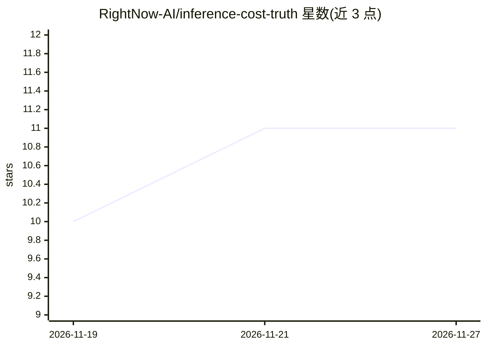

# RightNow-AI/inference-cost-truth

⭐ 11 · Python · NOASSERTION · 推送 2026-09-18 · [GitHub](https://github.com/RightNow-AI/inference-cost-truth) · [官网](https://runinfra.ai) · 组织维护

**LLM 推理成本与 GPU 租价核验数据集：每条数字带出处**

由 RightNow AI 维护的 LLM 推理成本开放数据集：收录 24 家供应商共 874 行经核验的价格数据、378 条 GPU 租用费率、395 条带引用的吞吐量数据点，以及自托管盈亏平衡模型。每条数字附来源 URL 与读取日期，并经三道机械化校验门检查，未通过即删除；以日期化不可变快照发布，许可为 CC BY 4.0。README 明确声明它不是质量基准、不构成推荐，并披露维护方存在利益关联。

## 筛选速览

| 维度 | 判定 | 备注 |
|---|---|---|
| AI 角色 | `ai-knowledge` | 知识聚合/清单类 |
| 许可风险 | `none` | NOASSERTION |
| 部署形态 | `None` |  |
| 模型依赖 | — | README 未给出锁定关系 |
| 硬件要求 | — | 无带数字的原话,不猜 |
| 安装摩擦 | `low` | 无编译、无系统依赖或容器化 |
| 成熟度 | — | 结构信号不足 |

## 能力要点

- 874 行核验价格覆盖 24 家供应商，附来源 URL 与读取日期
- 三道机械校验门，未通过证据检查的数字被删除
- 378 条 GPU 租用费率与自托管盈亏平衡模型
- 日期化不可变快照，CC BY 4.0 许可

## 适用场景

- 为模型服务采购决策查找带出处的 API 定价数据
- 对比自托管 GPU 与托管 API 的成本盈亏平衡点
- 复用开放数据进行推理成本研究或引用核实

## 场景标签

`模型评测` · 领域:评测与运维

## 证据(README 行号)

> L3: What LLM inference actually costs, per million tokens, across closed APIs,
> L32: - Not complete. Blank cells marked "not documented" or "not measured" are
> L37: Three mechanical gates, run by the maintainer, not by the agent that collected

## 星数曲线

2026-11-19 10 → 2026-11-27 11（+1）

---
*卡片 v1 · prompt 1.4 · 生成 2026-11-20 · 置信度 high · 依据 README sha `f595c09b2fb5` · [字段定义](../../DATASET.md)*
