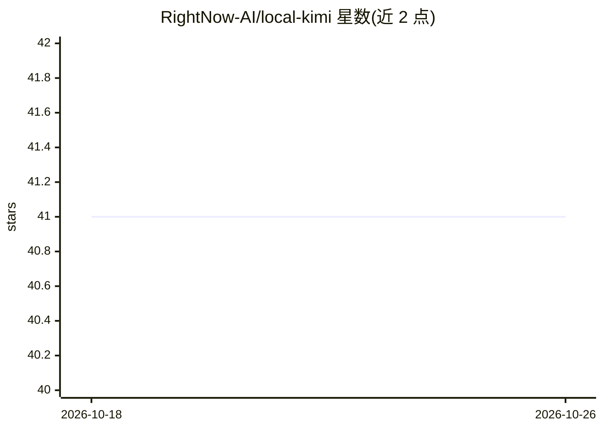

# RightNow-AI/local-kimi

⭐ 41 · Python · Apache-2.0 · 推送 2026-09-18 · [GitHub](https://github.com/RightNow-AI/local-kimi) · [官网](https://runinfra.ai) · 组织维护

**在单张 32GB GPU 上本地服务 Kimi-Linear-48B 的引擎与协议适配层**

面向希望本地运行 Kimi-Linear-48B 的开发者：仓库包含 INT4 量化流程（产物 26.83 GiB）、经测量的融合 W4A16 GEMV 解码内核（L40S 上 113.83 tok/s），以及 k3 独立适配器——逐请求检测客户端类型，在 Anthropic Messages、OpenAI Responses 与 Chat Completions 协议间翻译，使 Claude Code、Codex、Cline、Aider、opencode 无改动接入已有 OpenAI 兼容后端。k3 本身不做推理，需 ≥32GB VRAM 显卡；另有闭源商业包 K3Turbo 服务完整 Kimi K3，与本仓库分开分发。

## 筛选速览

| 维度 | 判定 | 备注 |
|---|---|---|
| AI 角色 | `ai-ecosystem` | LLM/agent 周边工具 |
| 许可风险 | `permissive` | Apache-2.0 |
| 部署形态 | `self-host` | docker 或自建部署 |
| 模型依赖 | locked-api |  |
| 硬件要求 | — | 无带数字的原话,不猜 |
| 安装摩擦 | `low` | 无编译、无系统依赖或容器化 |
| 成熟度 | — | 结构信号不足 |

## 能力要点

- INT4 量化产物 26.83 GiB，可在单张 32GB 显卡上服务 48B 模型
- 融合 W4A16 GEMV 内核，L40S 实测解码 113.83 tok/s
- k3 按请求检测客户端并在三套协议间翻译，多个编码 agent 无改动接入
- 内核经注册表与等价性测试对比，快速内核默认开启

## 适用场景

- 在本地 GPU 上为 Claude Code、Codex 等编码 agent 提供 Kimi 模型后端
- 把只说 OpenAI Chat Completions 的现有服务端接入 Anthropic/OpenAI Responses 客户端
- 复现论文级的量化与内核测量结果

## 场景标签

`推理引擎` `模型量化` `模型网关` · 领域:Agent 开发

## 证据(README 行号)

> L18: Point any coding agent at a local Kimi model and it works: `k3` translates between the agent's protocol and the mod
> L36: Local model servers usually speak OpenAI Chat Completions. Claude Code speaks Anthropic Messages. Codex speaks Open
> L40: The protocol landscape has changed. Current releases of vLLM, llama.cpp, and Ollama now document all three protocol

## 星数曲线

2026-10-18 41 → 2026-10-26 41（+0）

---
*卡片 v1 · prompt 1.4 · 生成 2026-10-25 · 置信度 mid · 依据 README sha `da39f75c40c9` · [字段定义](../../DATASET.md)*
