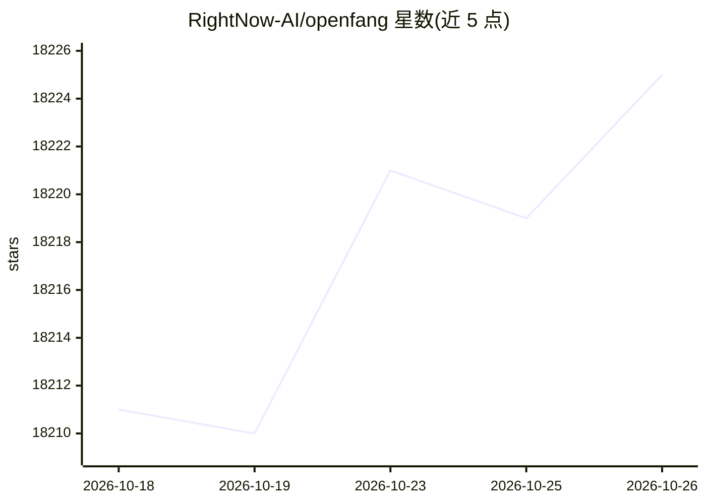

# RightNow-AI/openfang

⭐ 18,225 · Rust · Apache-2.0 · 推送 2026-07-02 · [GitHub](https://github.com/RightNow-AI/openfang) · [官网](https://www.openfang.sh/) · 组织维护

**给需要自主运行的 agent 的 Rust 单二进制操作系统**

用 Rust 编写的开源 Agent OS，编译为约 32MB 的单个二进制文件，含 14 个 crate 与 1,767+ 测试。核心概念是 Hands：预置的自主能力包（HAND.toml 清单+系统提示词+SKILL.md+审批护栏），按计划独立运行，内置 Clip、Lead、Collector、Predictor、Researcher、Twitter、Browser 共 7 个。系统自带 16 项安全机制（WASM 沙箱、Merkle 审计链、提示注入扫描等）、40 个频道适配器、SQLite+向量记忆与 Web 仪表盘。当前为 pre-1.0 版本，README 提示小版本间可能有破坏性变更。

## 筛选速览

| 维度 | 判定 | 备注 |
|---|---|---|
| AI 角色 | `ai-native` | 本体是模型或模型工具 |
| 许可风险 | `permissive` | Apache-2.0 |
| 部署形态 | `self-host` | docker 或自建部署 |
| 模型依赖 | — | README 未给出锁定关系 |
| 硬件要求 | — | 无带数字的原话,不猜 |
| 安装摩擦 | `low` | 无编译、无系统依赖或容器化 |
| 成熟度 | `idea` | |

## 动量与使用信号

- 维护:`maintenance` — 距上次 push 108.0 天,年发版 100,64 位贡献者
- 涨星:近 1 天 **-3**(自 20261016 起算)
- 平台:WINDOWS · 协议:OPENAI-API / MCP / OLLAMA

## 能力要点

- 7 个内置自主 Hand，按计划运行无需人工提示
- 编译为单个约 32MB 二进制，Hand 全部编译进二进制无需额外下载
- 16 项安全机制：WASM 沙箱、Merkle 哈希链审计、Ed25519 签名清单、提示注入扫描等
- 40 个频道适配器（Telegram/Discord/Slack/飞书/钉钉等），支持按频道覆盖模型

## 适用场景

- 让 agent 定时跑竞品监控、线索挖掘并推送到 Telegram
- 自主管理 Twitter/X 账号内容与回复（带审批队列）
- 通过浏览器 Hand 自动化填表与多步网页流程（购买需人工确认）

## 场景标签

`Agent 框架` · 领域:Agent 开发

## 证据(README 行号)

> L26: OpenFang is an **open-source Agent Operating System**. Not a chatbot framework. Not a Python wrapper around an LLM.
> L30: The entire system compiles to a **single ~32MB binary**. One install, one command, your agents are live.
> L203: openfang-api         140+ REST/WS/SSE endpoints, OpenAI-compatible API, dashboard

## 星数曲线

2026-10-18 18,211 → 2026-10-26 18,225（+14）

---
*卡片 v1 · prompt 1.4 · 生成 2026-10-18 · 置信度 low · 依据 README sha `4305e983d6e8` · [字段定义](../../DATASET.md)*
