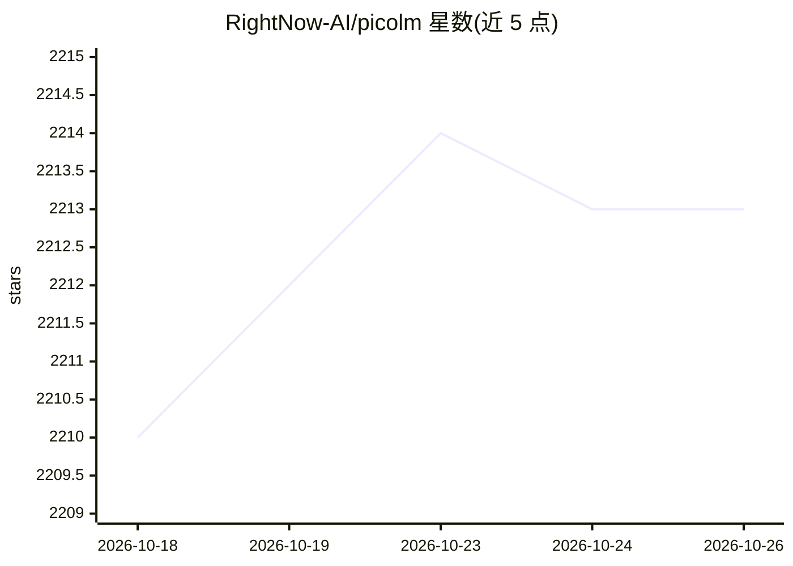

# RightNow-AI/picolm

⭐ 2,213 · C · MIT · 推送 2026-02-22 · [GitHub](https://github.com/RightNow-AI/picolm) · [官网](https://www.rightnowai.co/forge) · 组织维护

**纯 C 实现的超轻量 LLM 推理引擎，可在 256MB 内存开发板运行**

用约 2,500 行 C11 从零实现的 LLM 推理引擎，零外部依赖（仅 libc/libm/libpthread），单一约 80KB 二进制。直接读取 GGUF v2/v3 格式的 LLaMA 架构模型（TinyLlama 1.1B、Llama 2 7B、Phi-2），支持 Q2_K–Q8_0 等量化格式；通过 mmap 分层流式加载将运行内存压至约 45MB，含 FP16 KV cache、Flash Attention、ARM NEON/x86 SSE2 SIMD、多线程 matmul、语法约束 JSON 输出与 KV cache 持久化等 9 项优化。面向在 Raspberry Pi、RISC-V 开发板等低内存设备上离线运行 LLM 的开发者，作为 PicoClaw 离线 agent 的本地推理后端，从源码编译或一键脚本安装。

## 筛选速览

| 维度 | 判定 | 备注 |
|---|---|---|
| AI 角色 | `ai-ecosystem` | LLM/agent 周边工具 |
| 许可风险 | `permissive` | MIT |
| 部署形态 | `desktop` | 安装包/桌面程序 |
| 模型依赖 | local-ok | 支持本地模型 |
| 硬件要求 | — | 无带数字的原话,不猜 |
| 安装摩擦 | `medium` | 含编译或系统依赖之一 |
| 成熟度 | — | 结构信号不足 |

## 能力要点

- 零依赖 C11 实现，单一约 80KB 二进制，运行内存约 45MB
- 原生读取 GGUF v2/v3，支持 Q2_K/Q4_K/Q8_0 等量化格式
- --json 语法约束模式保证小模型输出合法 JSON（用于 tool calling）
- KV cache 持久化跳过重复 prefill，宣称重复系统提示延迟降低 74%

## 适用场景

- 在 Raspberry Pi / RISC-V 等低内存开发板上离线运行 1B 级 LLM
- 作为离线 AI agent（PicoClaw）的本地推理后端，通过 stdin/stdout 管道集成
- 在无网络、无 API key 环境下以管道方式批量生成文本或结构化 JSON

## 场景标签

`推理引擎` · 领域:训练与推理

## 证据(README 行号)

> L104: PicoLM is a **minimal, from-scratch LLM inference engine** written in ~2,500 lines of C11. It runs TinyLlama 1.1B 
> L137: |**Pipe-friendly**|Reads prompts from stdin: `echo "Hello" \|./picolm model.gguf`|

## 星数曲线

2026-10-18 2,210 → 2026-10-26 2,213（+3）

---
*卡片 v1 · prompt 1.4 · 生成 2026-10-21 · 置信度 high · 依据 README sha `d922720e15e3` · [字段定义](../../DATASET.md)*
