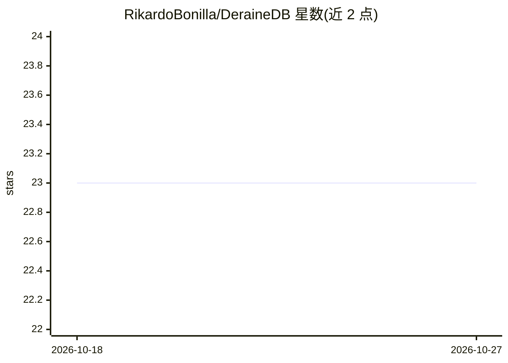

# RikardoBonilla/DeraineDB

⭐ 23 · Zig · Apache-2.0 · 推送 2026-09-21 · [GitHub](https://github.com/RikardoBonilla/DeraineDB) · 个人维护

**面向边缘与本地 RAG 的轻量嵌入式向量数据库引擎**

用 Zig 与 Go 构建的嵌入式向量搜索引擎，面向边缘设备与本地 RAG 应用：Zig 核心以内存映射文件承载向量与 HNSW 索引，Go 编排层通过零拷贝 CGO 桥接 gRPC 请求，元数据用 uint64 位掩码在 HNSW 路由热循环内做位运算过滤。README 报告 33.7MB Docker 镜像、约 21MiB 运行内存与亚毫秒 HNSW 检索的压测数据。提供 Docker 部署与 Python/Go/Rust/JS 官方 SDK。

## 筛选速览

| 维度 | 判定 | 备注 |
|---|---|---|
| AI 角色 | `ai-ecosystem` | LLM/agent 周边工具 |
| 许可风险 | `permissive` | Apache-2.0 |
| 部署形态 | `self-host` | docker 或自建部署 |
| 模型依赖 | — | README 未给出锁定关系 |
| 硬件要求 | — | 无带数字的原话,不猜 |
| 安装摩擦 | `low` | 无编译、无系统依赖或容器化 |
| 成熟度 | — | 结构信号不足 |

## 能力要点

- Zig 核心：内存映射 .drb 文件存储向量，HNSW 图隔离于 .dridx 文件
- 零拷贝 CGO 桥接：Protobuf 切片直接映射进 Zig 内存空间
- uint64 位掩码元数据过滤在 HNSW 贪心路由内完成
- 提供 Python/Go/Rust/JS 四种官方 SDK

## 适用场景

- 在资源受限设备上为本地 RAG 应用提供向量检索
- 替代重型依赖部署、用小镜像跑向量搜索服务
- 通过 gRPC 与多语言 SDK 接入向量检索后端

## 场景标签

`向量数据库` · 领域:知识与检索

## 证据(README 行号)

> L8: DeraineDB is a hyper-optimized, embedded vector search engine built for the Edge and local RAG (Retrieval-Augmented 
> L58: * **Python SDK:** AI-ready wrapper.

## 星数曲线

2026-10-18 23 → 2026-10-27 23（+0）

---
*卡片 v1 · prompt 1.4 · 生成 2026-10-27 · 置信度 high · 依据 README sha `0fa07e92404e` · [字段定义](../../DATASET.md)*
