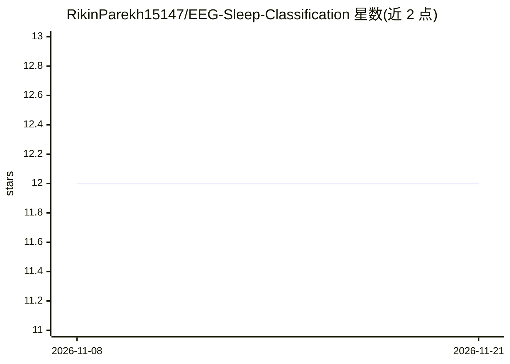

# RikinParekh15147/EEG-Sleep-Classification

⭐ 12 · Jupyter Notebook · MIT · 推送 2026-11-09 · [GitHub](https://github.com/RikinParekh15147/EEG-Sleep-Classification) · 组织维护

**给学生/研究者做 EEG 睡眠分期与睡眠结构画像的工具**

基于 HMC 数据集 24 条记录训练的 Fast SCFormer-U 分类器，对 30 秒 EEG epoch 做五类睡眠分期，并用仅在训练集拟合的谱特征逻辑回归细化 N1/N2 判别；在测试集上报告准确率与各类 F1。配套 Electron/React 桌面应用 Sleep Studio，用于查看睡眠图、不确定性、描述性画像并导出报告；复现实验通过 Colab 运行 reproduce.py。README 明确说明未经临床验证，不做诊断用途。

## 筛选速览

| 维度 | 判定 | 备注 |
|---|---|---|
| AI 角色 | `ai-native` | 本体是模型或模型工具 |
| 许可风险 | `permissive` | MIT |
| 部署形态 | `library` | 以包/库形式分发 |
| 模型依赖 | — | README 未给出锁定关系 |
| 硬件要求 | — | 无带数字的原话,不猜 |
| 安装摩擦 | `low` | 无编译、无系统依赖或容器化 |
| 成熟度 | — | 结构信号不足 |

## 能力要点

- Fast SCFormer-U 五类睡眠分期（226,309 参数）
- N1/N2 Welch 谱特征 + 仅训练集拟合的逻辑回归细化
- 基于训练参考区间的记录级睡眠结构画像
- Sleep Studio 桌面应用查看/导出 PDF、JSON、CSV、ZIP 报告

## 适用场景

- 对预处理好的 EEG 数据做自动睡眠分期
- 查看分期结果的睡眠图与不确定性并导出报告
- 复现论文实验中的 N1/N2 细化流程

## 场景标签

`科研工具` · 领域:学习与行业

## 证据(README 行号)

> L3: Automated EEG sleep staging using a retained Fast SCFormer-U classifier, targeted N1/N2 spectral refinement, and rec
> L23: Sleep duration alone does not describe interruptions or the distribution of sleep stages. Stage sequences allow sle
> L27: The implemented objectives are five-class epoch classification, training-only spectral refinement, descriptive arch

## 星数曲线

2026-11-08 12 → 2026-11-21 12（+0）

---
*卡片 v1 · prompt 1.4 · 生成 2026-11-18 · 置信度 high · 依据 README sha `63cc47f6f595` · [字段定义](../../DATASET.md)*
