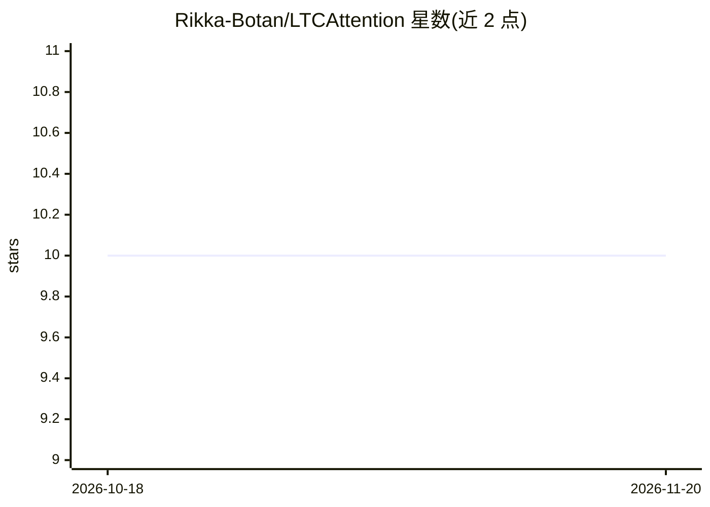

# Rikka-Botan/LTCAttention

⭐ 10 · Python · MIT · 推送 2026-08-09 · [GitHub](https://github.com/Rikka-Botan/LTCAttention) · 个人维护

**研究者的自适应记忆衰减自注意力语言模型实现**

LTCAttention 的官方实现：在因果自注意力中引入输入条件、随时间变化的 Householder 形式度量，借鉴 Liquid Time-constant Networks 的正输入条件时间常数与 Gated Delta Networks 的自适应模态保留原理，实现 SSM 式自适应记忆衰减，同时保留 softmax 注意力。代码聚焦模型本身，模型组件（模态 LTC 门与 KV cache）集中在单个 model.py 中；提供 nanoGPT 风格训练器、FineWeb-Edu 数据准备脚本、KV 缓存推理与基准测试脚本。参考配置为 29M 参数模型，含三种子对照实验结果；作者声明三个种子与单一小规模不能确立广泛缩放行为。

## 筛选速览

| 维度 | 判定 | 备注 |
|---|---|---|
| AI 角色 | `ai-native` | 本体是模型或模型工具 |
| 许可风险 | `permissive` | MIT |
| 部署形态 | `None` |  |
| 模型依赖 | — | README 未给出锁定关系 |
| 硬件要求 | — | 无带数字的原话,不猜 |
| 安装摩擦 | `medium` | 含编译或系统依赖之一 |
| 成熟度 | — | 结构信号不足 |

## 能力要点

- 输入条件时间常数的模态衰减嵌入注意力 logits，无需构造 T×T 矩阵
- 单文件 model.py 包含完整模型与 KV cache 实现
- 提供 FineWeb-Edu 流式去重数据准备与三种子受控训练配置
- 附三种子对照实验：验证损失 4.07281±0.01777、困惑度 58.73

## 适用场景

- 复现或研究自适应记忆衰减注意力机制
- 在 29M 参考配置上训练与评估语言模型
- 基于 KV cache 做逐 token 推理与基准测量

## 场景标签

`模型训练` · 领域:训练与推理

## 证据(README 行号)

> L7: LTCAttention is a compact, nanoGPT-style language model that adds an
> L17: The repository is intentionally model-focused: every model component,
> L21: This release contains only the LTC model. It does not expose a conventional

## 星数曲线

2026-10-18 10 → 2026-11-20 10（+0）

---
*卡片 v1 · prompt 1.4 · 生成 2026-11-20 · 置信度 high · 依据 README sha `639afd367a50` · [字段定义](../../DATASET.md)*
