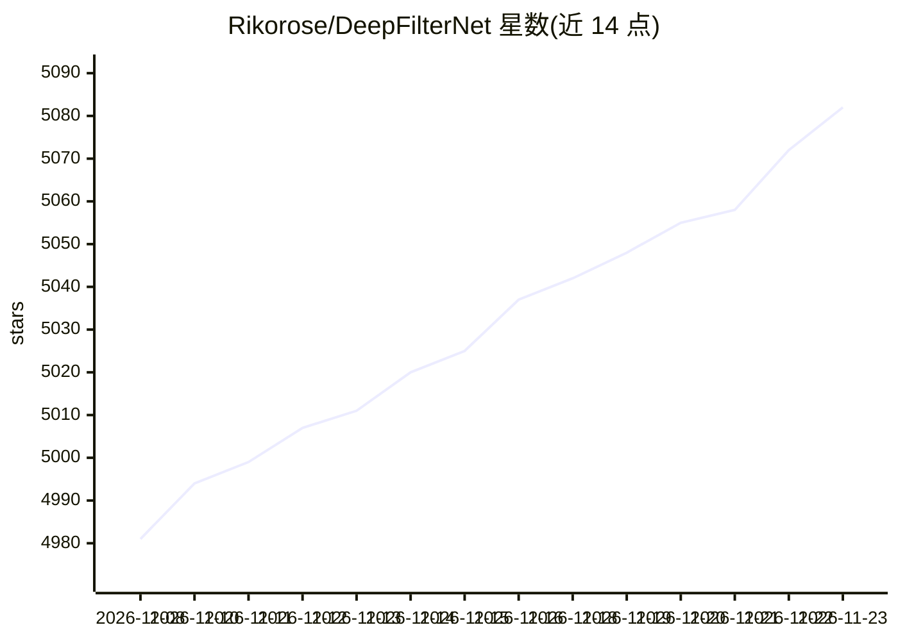

# Rikorose/DeepFilterNet

⭐ 5,082 · Python · NOASSERTION · 推送 2026-11-06 · [GitHub](https://github.com/Rikorose/DeepFilterNet) · [官网](https://huggingface.co/spaces/hshr/DeepFilterNet2) · 组织维护

**全频带音频（48kHz）实时语音降噪框架，基于深度滤波**

DeepFilterNet 是面向全频带音频（48kHz）的低复杂度语音增强框架，基于深度滤波（Deep Filtering）实现噪声抑制。提供预编译的 deep-filter 二进制（无 Python 依赖）处理 wav 文件、LADSPA 插件配合 PipeWire 实现麦克风实时降噪，以及 Python wheel（PyTorch 后端，支持 GPU）。框架包含 Rust 数据加载/增强库、训练与评估代码和预训练模型权重，训练仅在 Linux 下测试，CLI 目前只支持 48kHz 采样率的 wav 文件。

## 筛选速览

| 维度 | 判定 | 备注 |
|---|---|---|
| AI 角色 | `ai-native` | 本体是模型或模型工具 |
| 许可风险 | `none` | NOASSERTION |
| 部署形态 | `desktop` | 安装包/桌面程序 |
| 模型依赖 | — | README 未给出锁定关系 |
| 硬件要求 | — | 无带数字的原话,不猜 |
| 安装摩擦 | `medium` | 含编译或系统依赖之一 |
| 成熟度 | — | 结构信号不足 |

## 能力要点

- 预编译二进制 deep-filter 可直接对 48kHz wav 文件降噪
- LADSPA 插件配合 PipeWire 过滤链实现麦克风实时降噪
- 提供 Python wheel（pip 安装）与 PyTorch GPU 后端
- 包含训练管线（HDF5 数据集）与预训练模型权重

## 适用场景

- 清理带噪声的录音 wav 文件
- 在 Linux 桌面上为麦克风做实时降噪虚拟输入
- 复现论文指标或用自己的语音/噪声数据训练降噪模型

## 场景标签

 · 领域:音频/语音处理

## 证据(README 行号)

> L2: A Low Complexity Speech Enhancement Framework for Full-Band Audio (48kHz) using on Deep Filtering.
> L27:  - Pre-compiled binary, no python dependencies. Usage: `deep-filter audio-file.wav`

## 星数曲线

2026-11-08 4,981 → 2026-11-23 5,082（+101）

---
*卡片 v1 · prompt 1.4 · 生成 2026-11-17 · 置信度 high · 依据 README sha `c39c34bae19e` · [字段定义](../../DATASET.md)*
