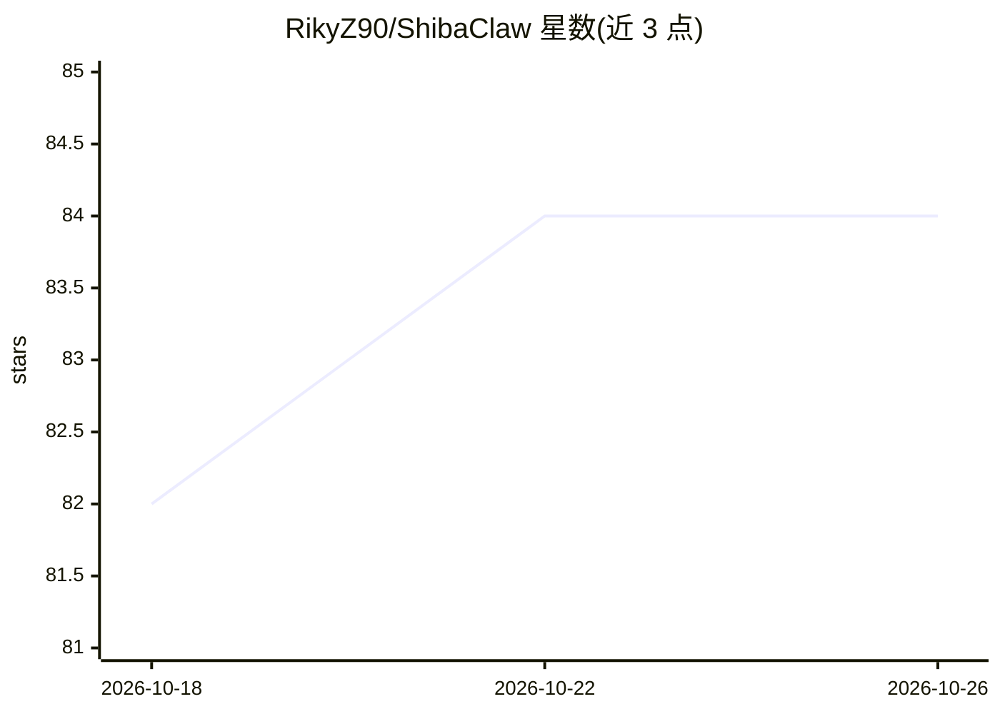

# RikyZ90/ShibaClaw

⭐ 84 · Python · Apache-2.0 · 推送 2026-10-25 · [GitHub](https://github.com/RikyZ90/ShibaClaw) · [官网](https://rikyz90.github.io/ShibaClaw/) · 个人维护 · 中文 README

**自托管安全优先的 AI agent：自带 WebUI 与 28 个模型接入**

在本地机器或服务器运行的 Python AI agent，含内置 WebUI（Starlette + WebSocket）、Windows 桌面应用与移动端访问。以原生 SDK 接入 28 个模型提供商（API key、网关/代理、OAuth、本地端点如 Ollama/vLLM 均可），并集成 Discord、Telegram、Slack、Matrix、钉钉、飞书、QQ 等 11 个聊天平台。安全机制内置：安装时 CVE 审计、提示注入包裹、SSRF 防护、工作区沙箱。提供三级记忆（工作/FAISS 语义/程序性）、MCP 连接、任务调度与自动化。安装途径含自动安装脚本、Docker Compose 与 pip。

## 筛选速览

| 维度 | 判定 | 备注 |
|---|---|---|
| AI 角色 | `ai-native` | 本体是模型或模型工具 |
| 许可风险 | `permissive` | Apache-2.0 |
| 部署形态 | `desktop` | 安装包/桌面程序 |
| 模型依赖 | local-ok | 支持本地模型 |
| 硬件要求 | — | 无带数字的原话,不猜 |
| 安装摩擦 | `low` | 无编译、无系统依赖或容器化 |
| 成熟度 | — | 结构信号不足 |

## 能力要点

- 28 个模型提供商原生 SDK 接入（含本地 Ollama/vLLM/llama.cpp 端点）
- 安全机制内置核心：安装时 CVE 审计、提示注入随机边界包裹、SSRF/DNS-rebinding 防护
- 三级记忆架构（工作记忆/FAISS 语义记忆/程序性记忆）与 WebUI 管理
- 11 个聊天平台集成（Discord/Telegram/Slack/WhatsApp/Matrix/钉钉/飞书/QQ 等）

## 适用场景

- 在自己服务器上运行可从手机和聊天平台访问的 AI agent
- 通过 MCP 与 Klavis OAuth 连接 Gmail、Google Drive、GitHub 等 SaaS 工具
- 以本地模型端点零 API 成本运行 agent
- 利用任务调度与程序性记忆（技能）自动化重复工作流

## 场景标签

`Agent 框架` `工作流自动化` `AI 助手` · 领域:Agent 开发

## 证据(README 行号)

> L41: ShibaClaw is a self-hosted AI agent you run on your own machine or server: a Python engine with a built-in web UI, 
> L55: - **28 providers, native SDKs** — OpenAI, Anthropic, Gemini, DeepSeek, and more, no LiteLLM proxy layer

## 星数曲线

2026-10-18 82 → 2026-10-26 84（+2）

---
*卡片 v1 · prompt 1.4 · 生成 2026-10-24 · 置信度 high · 依据 README sha `3e127ed97e00` · [字段定义](../../DATASET.md)*
