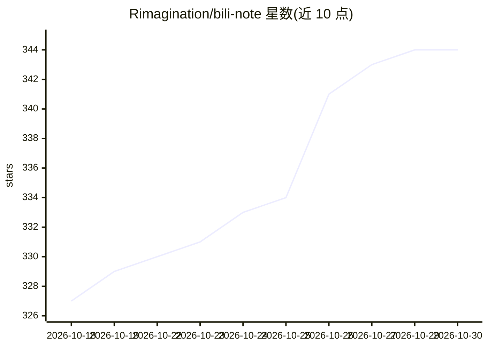

# Rimagination/bili-note

⭐ 344 · Python · MIT · 推送 2026-09-22 · [GitHub](https://github.com/Rimagination/bili-note) · 个人维护 · 中文 README

**把 B 站视频/图文整理成学习型 Markdown 笔记的 Agent 技能**

以 Agent skill（含 SKILL.md 工作流与 Python 脚本）形式提供：读取 B 站视频或图文链接，归档完整字幕、正文、图片、评论、元数据与证据索引，按内容信息量和质量动态确定笔记预算，生成带论文式证据编号链接的学习型 Markdown 主笔记与材料包。字幕路线按优先级选择公开字幕、网页 AI 字幕、Qwen3-ASR 或 Whisper 兜底，可选关键帧视觉理解（最多 12 帧）。面向使用 Agent 的知识库用户，依赖 Python 3.10+ 与 B 站网络访问，部分能力需 ffmpeg、登录浏览器等增强依赖，缺失时跳过对应路线。

## 筛选速览

| 维度 | 判定 | 备注 |
|---|---|---|
| AI 角色 | `ai-native` | 本体是模型或模型工具 |
| 许可风险 | `permissive` | MIT |
| 部署形态 | `desktop` | 安装包/桌面程序 |
| 模型依赖 | — | README 未给出锁定关系 |
| 硬件要求 | — | 无带数字的原话,不猜 |
| 安装摩擦 | `medium` | 含编译或系统依赖之一 |
| 成熟度 | — | 结构信号不足 |

## 能力要点

- 完整归档字幕/正文/图片/评论/元数据与 JSONL 证据索引
- 写前定标：先生成推荐字数、压缩比与写作粒度再写笔记
- 多级字幕路线：公开字幕/网页 AI 字幕/Qwen3-ASR/Whisper 可指定后端
- 关键帧视觉理解：最多 12 帧 4×3 联系图，控制视觉 tokens

## 适用场景

- 把 B 站技术视频或课程整理进 Obsidian 等知识库
- 保存完整字幕与评论供 Agent 检索和后续问答
- 长视频无字幕时补充关键帧视觉信息再生成笔记

## 场景标签

`知识库管理` `语音识别` · 领域:知识与检索

## 证据(README 行号)

> L9: Bili Note 是一个面向知识库的 B 站视频与图文笔记工具：完整归档字幕、图文正文、图片与评论，按内容信息量和质量动态控制笔记长度，把 B 站内容整理成可学习、可检索、可追问的 Markdown 笔记。
> L13: - 完整归档：保存完整字幕、图文正文、图片、完整评论、元数据和证据索引，主笔记中的关键判断可以通过论文式编号链接回到原文位置复核。

## 星数曲线

2026-10-18 327 → 2026-10-30 344（+17）

---
*卡片 v1 · prompt 1.4 · 生成 2026-10-21 · 置信度 mid · 依据 README sha `8e44ef12e9eb` · [字段定义](../../DATASET.md)*
