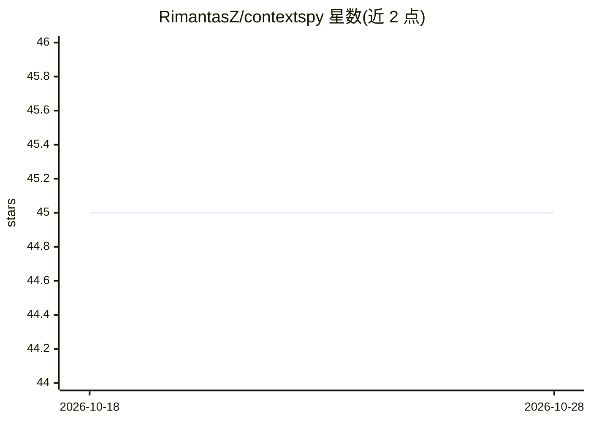

# RimantasZ/contextspy

⭐ 45 · Python · Apache-2.0 · 推送 2026-10-23 · [GitHub](https://github.com/RimantasZ/contextspy) · 个人维护

**LLM/AI 编码代理的上下文窗口剖析器：拦截请求、分解 token 构成**

面向 AI 编码代理使用者的上下文画像工具：启动 HTTPS 代理（云端 API 前向代理 / 本地模型反向代理）捕获 LLM 请求，将输入 token 拆分为系统提示、工具定义、工具结果、文件内容、对话历史等 8 类，存入本地 SQLite，并在 localhost Web 仪表盘中可视化 session、延迟、工具使用树图与请求负载。数据全部本地存储；定位为分析会话用的 profiler 而非常驻监控。提供 PyPI、Homebrew、.deb 与独立二进制安装。

## 筛选速览

| 维度 | 判定 | 备注 |
|---|---|---|
| AI 角色 | `ai-ecosystem` | LLM/agent 周边工具 |
| 许可风险 | `permissive` | Apache-2.0 |
| 部署形态 | `library` | 以包/库形式分发 |
| 模型依赖 | local-ok | 支持本地模型 |
| 硬件要求 | — | 无带数字的原话,不猜 |
| 安装摩擦 | `low` | 无编译、无系统依赖或容器化 |
| 成熟度 | — | 结构信号不足 |

## 能力要点

- 代理拦截请求并将输入 token 分解为 8 个类别
- 支持云端 API（OpenAI/Anthropic/Azure/Copilot 等）与本地 LLM（Ollama/llama.cpp/vLLM）两种模式
- 本地 SQLite 存储与实时仪表盘（会话跟踪、对话分叉重建、工具使用树图）
- 会话归档、数据库压缩与手动清理等数据管理命令

## 适用场景

- 排查 AI 编码代理会话变慢、变贵或撞上下文窗口的原因
- 分析代理上下文中哪些部分（工具结果、历史等）占用 token
- 对比多次运行之间的 token 用量变化

## 场景标签

`LLM 可观测性` · 领域:评测与运维

## 证据(README 行号)

> L17: ContextSpy is a context window profiler for large language models and common agentic AI coding tools.
> L78: ContextSpy starts an HTTPS proxy (or reverse proxy for locally hosted models) that captures
> L79: supported LLM invocation endpoints, analyzes them, and stores the results in a local SQLite

## 星数曲线

2026-10-18 45 → 2026-10-28 45（+0）

---
*卡片 v1 · prompt 1.4 · 生成 2026-10-25 · 置信度 high · 依据 README sha `f2ecfd58cd10` · [字段定义](../../DATASET.md)*
