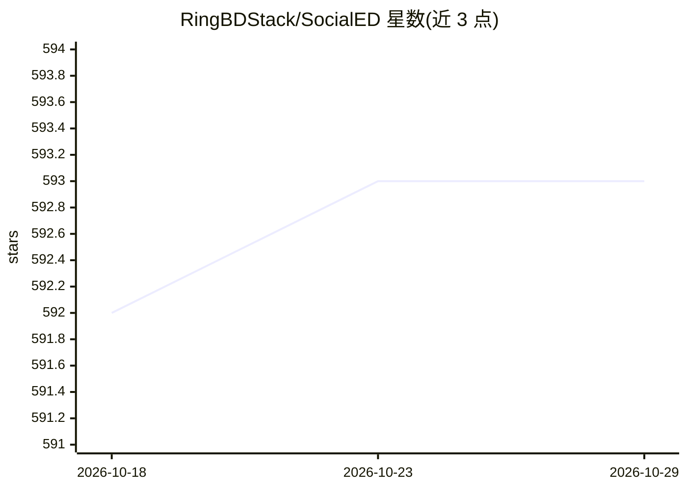

# RingBDStack/SocialED

⭐ 593 · Python · BSD-2-Clause · 推送 2026-10-02 · [GitHub](https://github.com/RingBDStack/SocialED) · [官网](https://github.com/ChenBeici/SocialED_datasets) · 组织维护

**社交事件检测 Python 库：19 种算法与 15 个数据集的统一工具包**

面向研究者和从业者的社交事件检测（SED）工具包，整合 19 种检测算法（LDA、BiLSTM、BERT、KPGNN、FinEvent、QSGNN、HISEvent、HyperSED 等）与 15 个数据集（Event2012、Event2018、Arabic_Twitter、MAVEN、CrisisLexT26 等），覆盖主题模型、词向量、PLM 与 GNN 多类骨干。基于 DGL 与 PyTorch 构建，API 设计遵循 PyOD/PyGOD，提供图构建与分词等预处理、统一的训练与预测接口和可替换的模块化组件。通过 pip 安装，需 Python>=3.8 及 torch、torch_geometric、dgl 等依赖。获 APWeb-WAIM 2025 最佳演示论文奖。

## 筛选速览

| 维度 | 判定 | 备注 |
|---|---|---|
| AI 角色 | `ai-native` | 本体是模型或模型工具 |
| 许可风险 | `permissive` | BSD-2-Clause |
| 部署形态 | `library` | 以包/库形式分发 |
| 模型依赖 | — | README 未给出锁定关系 |
| 硬件要求 | — | 无带数字的原话,不猜 |
| 安装摩擦 | `low` | 无编译、无系统依赖或容器化 |
| 成熟度 | — | 结构信号不足 |

## 能力要点

- 整合 19 种社交事件检测算法，覆盖离线/在线、有监督/无监督场景
- 支持 15 个公开数据集（Event2012/Event2018/MAVEN/CrisisLexT26 等）
- 基于 DGL 与 PyTorch，API 设计遵循 PyOD/PyGOD，统一训练与预测接口
- 提供图构建、分词等预处理与模块化可定制组件

## 适用场景

- 研究人员在同一框架下对比多种社交事件检测算法
- 舆情监测、危机管理等下游应用的事件检测建模
- 在公开推文数据集上复现或扩展 SED 方法

## 场景标签

`科研工具` · 领域:学习与行业

## 证据(README 行号)

> L15: A Python Library for Social Event Detection
> L48: - **🤖 Comprehensive Algorithm Collection**: Integrates 19 detection algorithms and supports 15 widely-used datasets
> L55: For consistency and accessibility, SocialED is developed on top of DGL

## 星数曲线

2026-10-18 592 → 2026-10-29 593（+1）

---
*卡片 v1 · prompt 1.4 · 生成 2026-10-21 · 置信度 high · 依据 README sha `fd0da857aee4` · [字段定义](../../DATASET.md)*
