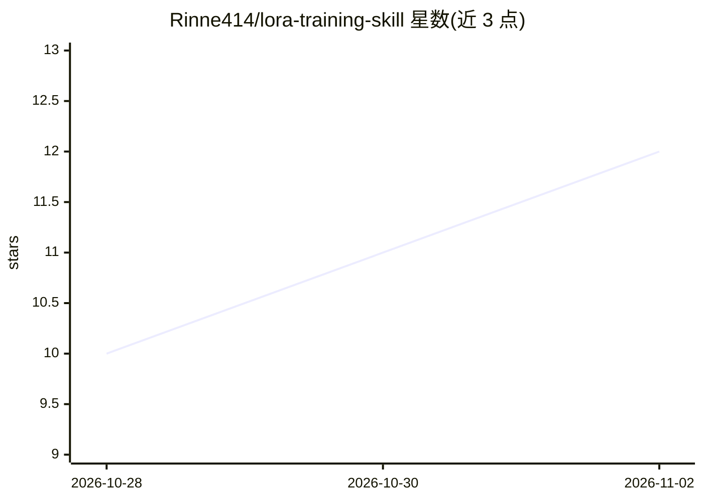

# Rinne414/lora-training-skill

⭐ 12 · Python · MIT · 推送 2026-10-26 · [GitHub](https://github.com/Rinne414/lora-training-skill) · 个人维护 · 中文 README

**Agent 技能套件：把图片文件夹引导式训练成 LoRA**

一组开放 SKILL.md 格式的 agent 技能（lora-pipeline / lora-trainer / dataset-doctor），围绕 lora-scripts-next 训练器构建质量门控的 LoRA 训练流程：从角色名或图片文件夹出发，自动收集（Danbooru）、整理、打标（WD14/Anima）、数据集体检（PASS/WARN/FAIL）、参数选取、一次确认后经训练器 HTTP API 启动训练，并可生成 Civitai 草稿（发布需手动点击）。修复默认 dry-run 且隔离不删除。需 SD-Trainer 训练器、Windows 10/11 + NVIDIA RTX 20 系以上 GPU；Anima 优先，支持 SD1.5/SDXL/Flux。

## 筛选速览

| 维度 | 判定 | 备注 |
|---|---|---|
| AI 角色 | `ai-ecosystem` | LLM/agent 周边工具 |
| 许可风险 | `permissive` | MIT |
| 部署形态 | `desktop` | 安装包/桌面程序 |
| 模型依赖 | — | README 未给出锁定关系 |
| 硬件要求 | — | 无带数字的原话,不猜 |
| 安装摩擦 | `low` | 无编译、无系统依赖或容器化 |
| 成熟度 | — | 结构信号不足 |

## 能力要点

- 三技能流水线：lora-pipeline 端到端 / lora-trainer 训练编排 / dataset-doctor 数据集体检
- 训练前 dataset-doctor 离线秒级审计并给出 PASS/WARN/FAIL，可作门控
- 数据集修复 dry-run 优先、确认后隔离原文件，从不删除
- 根据图片数与检测到的 VRAM 自动选取参数，训练前需一次明文确认

## 适用场景

- 我只有一文件夹图片，想让 agent 引导我完成 LoRA 训练
- 训练前先体检数据集，避免浪费 GPU 时间
- 从角色名出发自动收集、打标、训练并生成 Civitai 草稿

## 场景标签

`微调` `Agent 框架` · 领域:Agent 开发

## 证据(README 行号)

> L7: A small family of agent skills (open SKILL.md format)
> L8: that turns LoRA training on the `lora-scripts-next`
> L9: trainer (a.k.a. *Next Trainer* / SD-Trainer) into a guided, quality-gated training

## 星数曲线

2026-10-28 10 → 2026-11-02 12（+2）

---
*卡片 v1 · prompt 1.4 · 生成 2026-11-02 · 置信度 mid · 依据 README sha `8dca46622f66` · [字段定义](../../DATASET.md)*
