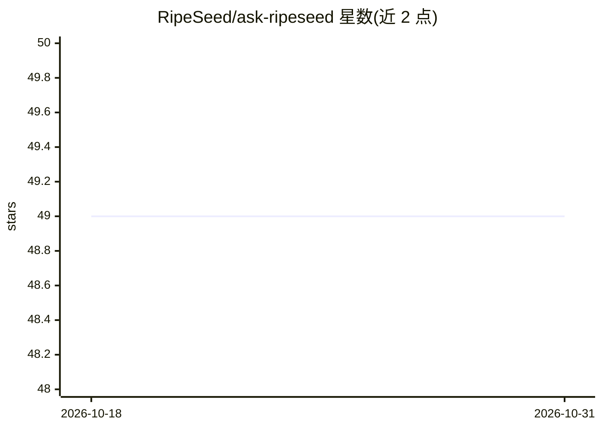

# RipeSeed/ask-ripeseed

⭐ 49 · TypeScript · MIT · 推送 2026-08-06 · [GitHub](https://github.com/RipeSeed/ask-ripeseed) · [官网](https://ask.ripeseed.io) · 组织维护

**面向代理公司的知识库问答 AI 助手（RAG 聊天应用）**

RipeSeed 团队开源的 Next.js 聊天应用：基于自有知识库（PDF 切块后向量化存入 Pinecone）回答客户关于团队能力与作品集的提问；另设 Ask Anything 区，用户本地存储 OpenAI API key 并上传自己的文档进行问答。技术栈含 LangChain、OpenAI、Pinecone、MongoDB，支持 DeepSeek 与 xAI（Grok）作为 LLM 提供方。本地运行需克隆仓库、配置多个环境变量并用 pnpm 安装启动；替换知识库需在 Jupyter/Colab 中运行切块与向量化脚本。

## 筛选速览

| 维度 | 判定 | 备注 |
|---|---|---|
| AI 角色 | `ai-native` | 本体是模型或模型工具 |
| 许可风险 | `permissive` | MIT |
| 部署形态 | `library` | 以包/库形式分发 |
| 模型依赖 | locked-api |  |
| 硬件要求 | — | 无带数字的原话,不猜 |
| 安装摩擦 | `low` | 无编译、无系统依赖或容器化 |
| 成熟度 | — | 结构信号不足 |

## 能力要点

- 知识库 RAG 问答（PDF→切块→Pinecone 向量检索）
- Ask Anything：用户上传自有文档问答，API key 存本地浏览器
- 支持 OpenAI / DeepSeek / xAI(Grok) 多个 LLM 提供方
- Markdown 渲染、聊天历史、会议预约 function calling

## 适用场景

- 代理公司/服务团队搭建展示自身能力与作品集的问答机器人
- 上传自有文档让访客基于文档内容提问
- 作为可替换知识库的 RAG 聊天应用模板二次开发

## 场景标签

`聊天机器人` `文档问答` · 领域:对话与助手

## 证据(README 行号)

> L19: Ask RipeSeed was originally developed to help potential customers see if our team (at RipeSeed) has the required ca
> L27: - **Ask RipeSeed**: Ask any questions related to RipeSeed, drawing from our knowledge base for accurate and specifi
> L28: - **Ask Anything**: Upload your OpenAI API key (which will be stored locally on browser) to ask general questions. 

## 星数曲线

2026-10-18 49 → 2026-10-31 49（+0）

---
*卡片 v1 · prompt 1.4 · 生成 2026-10-24 · 置信度 mid · 依据 README sha `0777c649843b` · [字段定义](../../DATASET.md)*
