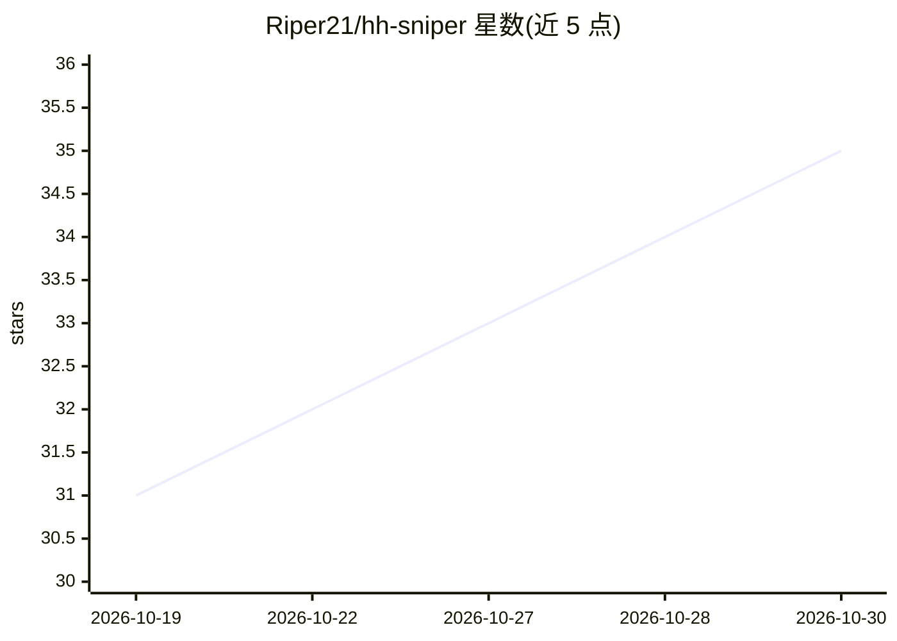

# Riper21/hh-sniper

⭐ 35 · Python · 推送 2026-10-19 · [GitHub](https://github.com/Riper21/hh-sniper) · 个人维护

**hh.ru 职位自动狙击器：LLM 打分、10 分钟内自动投递**

面向俄罗斯 hh.ru 求职者的本地自动化流水线：每分钟按关键词搜索新职位，去重并经薪资硬门槛过滤后由 LLM 做 0-100 匹配打分，附静态求职信自动或手动投递，autopilot 仅限发布 10 分钟内的新职位。LLM 仅用于打分，求职信为固定文本，投递前有守卫校验（数字须出自档案事实、链接须出自白名单）。另提供简历每 4 小时自动刷新、投递状态报告（nanny）、AI 筛选聊天自动应答、清理长期无回应投递、雇主黑名单等功能。全流程在本机或 Docker/VPS 运行，调用 hh.ru 官方 API，基于 vendored 的 hh-applicant-tool（Non-Commercial 许可）。配置集中在 config.toml，支持 Windows 任务计划、Linux systemd、macOS launchd 与 Docker 四种调度方式。

## 筛选速览

| 维度 | 判定 | 备注 |
|---|---|---|
| AI 角色 | `ai-enhanced` | 去掉 AI 部分产品仍成立 |
| 许可风险 | `none` | — |
| 部署形态 | `desktop` | 安装包/桌面程序 |
| 模型依赖 | — | README 未给出锁定关系 |
| 硬件要求 | — | 无带数字的原话,不猜 |
| 安装摩擦 | `low` | 无编译、无系统依赖或容器化 |
| 成熟度 | — | 结构信号不足 |

## 能力要点

- LLM 0-100 职位匹配打分，autopilot 仅投 10 分钟内新职位
- 求职信静态文本 + 守卫：数字限档案事实、链接限白名单
- 简历每 4 小时自动刷新提升曝光，nanny 报告雇主反应
- AI 筛选聊天自动应答（精确匹配按钮、档案事实守卫）

## 适用场景

- 求职者自动监控并快速投递 hh.ru 新职位
- 自动回复雇主 AI 筛选问卷并追踪投递状态
- 在 VPS 上 24/7 运行投递流水线

## 场景标签

`工作流自动化` · 领域:效率与自动化

## 证据(README 行号)

> L10: Автоматический снпрер вакансий с hh.ru: каждую минуту ищет свежие вакансии
> L11: по вашим запросам, оценивает их LLM на соответствие вашему профилю,
> L12: прикладывает сопроводительное письмо и откликается — вручную или автопилотом

## 星数曲线

2026-10-19 31 → 2026-10-30 35（+4）

---
*卡片 v1 · prompt 1.4 · 生成 2026-10-26 · 置信度 mid · 依据 README sha `adac6df128bb` · [字段定义](../../DATASET.md)*
