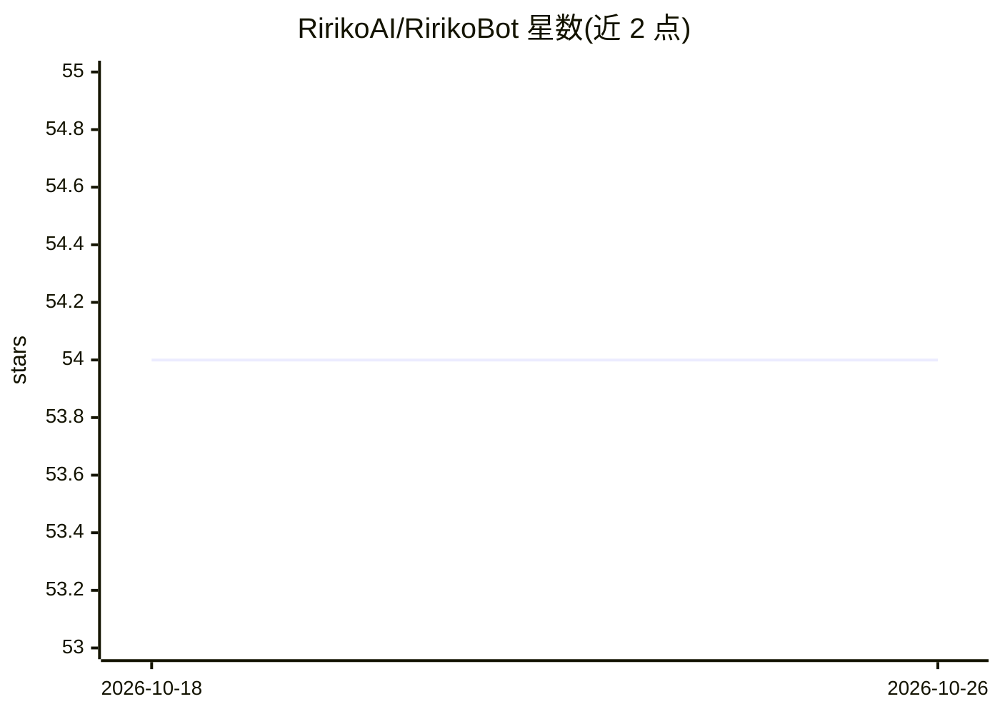

# RirikoAI/RirikoBot

⭐ 54 · TypeScript · MIT · 推送 2026-10-24 · [GitHub](https://github.com/RirikoAI/RirikoBot) · [官网](https://ririko.ai) · 组织维护

**多功能自托管 Discord 机器人，集成 AI 聊天、音乐与卡牌游戏**

Ririko AI 2.0.0 是一个用 TypeScript 全量重写的自托管多用途 Discord 机器人（基于 Discord.js v14）：音乐播放（经 Lavalink 4，支持 YouTube/Spotify/SoundCloud/Deezer）、AI 聊天与图像生成（Gemini、OpenAI 兼容 API、Ollama）、审核与 AutoMod、经济与等级系统、赠品活动、卡牌游戏 Waifu TCG，以及通过浏览器管理设置的 Web 仪表盘。自托管需运行机器人、仪表盘、PostgreSQL 与 Lavalink 四个组件，Docker Compose 一条命令启动；提供 npm 起步器 npx ririko 与源码安装两条路径，要求 Node.js 20+、Docker 23+。

## 筛选速览

| 维度 | 判定 | 备注 |
|---|---|---|
| AI 角色 | `ai-enhanced` | 去掉 AI 部分产品仍成立 |
| 许可风险 | `permissive` | MIT |
| 部署形态 | `self-host` | docker 或自建部署 |
| 模型依赖 | local-ok | 支持本地模型 |
| 硬件要求 | — | 无带数字的原话,不猜 |
| 安装摩擦 | `low` | 无编译、无系统依赖或容器化 |
| 成熟度 | — | 结构信号不足 |

## 能力要点

- AI 聊天与图像：支持 Gemini、OpenAI 兼容 API 与 Ollama，工具遵守 Discord 权限
- Web 仪表盘：Discord 登录后从浏览器管理每个服务器设置
- 一条 Docker Compose 命令启动 bot、仪表盘、PostgreSQL 与 Lavalink 四组件
- npx ririko 起步器带安装向导，自动写入 .env.production

## 适用场景

- 在自己的服务器上运行一个带 AI 聊天的多功能 Discord 机器人
- 通过网页仪表盘管理服务器设置而不用敲命令
- 搭建含音乐、经济、卡牌游戏的社区 Discord 服务器

## 场景标签

`聊天机器人` `图像生成` · 领域:对话与助手

## 证据(README 行号)

> L13: Ririko is a multipurpose Discord bot you host yourself. It plays music, chats with AI, moderates your server, runs 
> L20: |AI chat and images|Gemini, OpenAI-compatible APIs and Ollama, with tools that respect Discord permissions.|

## 星数曲线

2026-10-18 54 → 2026-10-26 54（+0）

---
*卡片 v1 · prompt 1.4 · 生成 2026-10-24 · 置信度 high · 依据 README sha `2a4404f9bd6c` · [字段定义](../../DATASET.md)*
