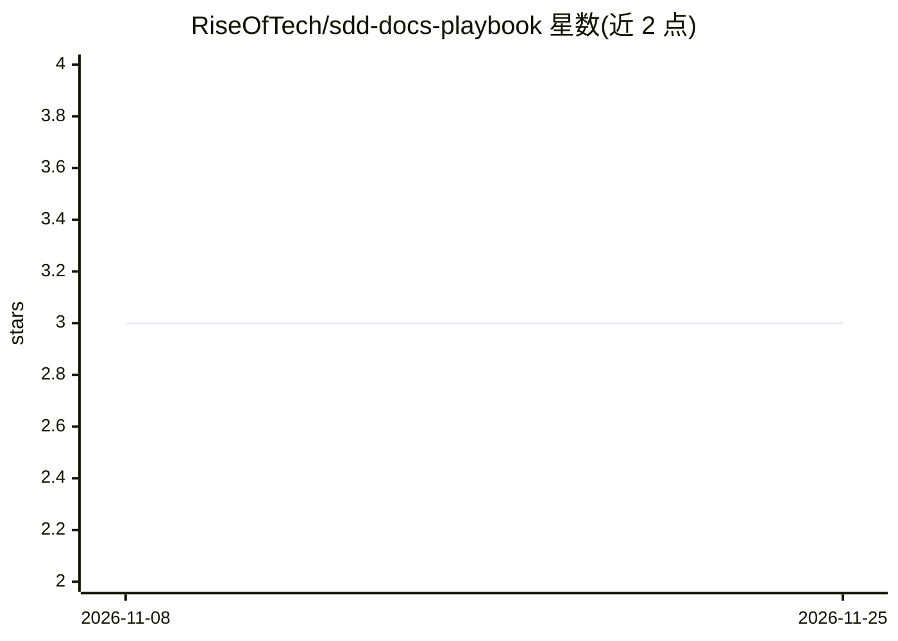

# RiseOfTech/sdd-docs-playbook

⭐ 3 · MIT · 推送 2026-11-05 · [GitHub](https://github.com/RiseOfTech/sdd-docs-playbook) · 个人维护

**给用 SDD 的项目提供文档模板与 AI agent 技能**

面向采用 spec-driven development 的项目，提供一套以复制方式引入的文档工程素材：项目地图、术语表、面向分析师与开发者的指南、文档撰写与更新规则，以及可在代码变更后更新和检查指南的 AI agent 技能。声明无需安装任何东西，直接把模板、提示词和技能复制进自己的项目。当前为 0.1 版本，提供英文与俄文双语 README，详细内容在 CHANGELOG 与后续文档中。

## 筛选速览

| 维度 | 判定 | 备注 |
|---|---|---|
| AI 角色 | `ai-knowledge` | 知识聚合/清单类 |
| 许可风险 | `permissive` | MIT |
| 部署形态 | `None` |  |
| 模型依赖 | — | README 未给出锁定关系 |
| 硬件要求 | — | 无带数字的原话,不猜 |
| 安装摩擦 | `low` | 无编译、无系统依赖或容器化 |
| 成熟度 | `idea` | |

## 能力要点

- 复制即用的模板、提示词与 AI agent 技能，无需安装
- 项目地图：标明各领域位置及应读的指南
- 术语表与统一的文档撰写/更新规则
- AI agent 技能在代码变更后更新并检查指南

## 适用场景

- 为 SDD 项目建立结构化的文档体系
- 让 AI agent 在代码变更后自动维护指南文档
- 帮助新成员快速了解项目从哪里入手

## 场景标签

`提示工程` `编码 Agent` · 领域:Agent 开发

## 证据(README 行号)

> L9: This library helps you bring order to the documentation of a project with SDD (spec-driven development). You copy te
> L17: - **AI agent skills:** they update and check guides after code changes.

## 星数曲线

2026-11-08 3 → 2026-11-25 3（+0）

---
*卡片 v1 · prompt 1.4 · 生成 2026-11-22 · 置信度 high · 依据 README sha `33120dd610e0` · [字段定义](../../DATASET.md)*
