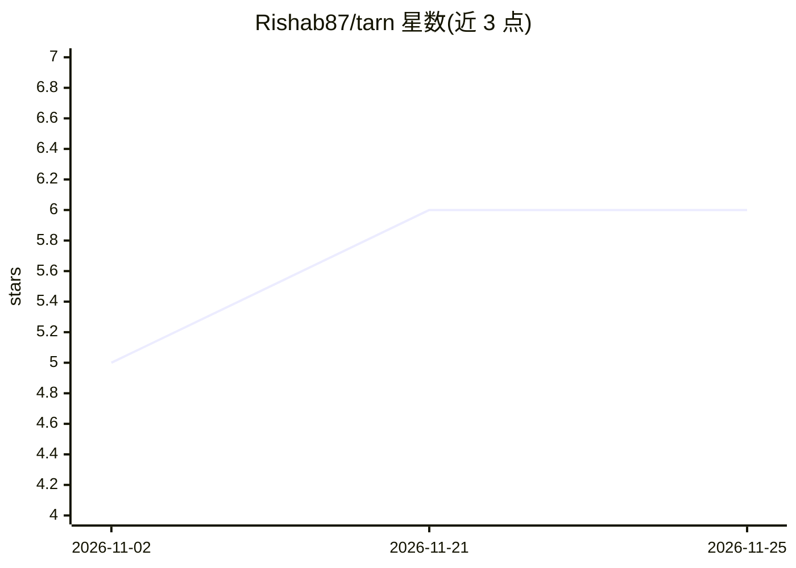

# Rishab87/tarn

⭐ 6 · Swift · MIT · 推送 2026-11-06 · [GitHub](https://github.com/Rishab87/tarn) · [官网](https://tarn-ai.vercel.app) · 个人维护

**在 Mac 本地运行开源模型的隐私 AI 聊天应用**

原生 SwiftUI macOS 应用，通过 llama.cpp 在本机运行开源模型，无需账号与云端。首次启动读取芯片与内存，自动匹配下载模型；提供跨对话记忆、DuckDuckGo 联网搜索、视觉识别图片、文件夹内读写与执行命令（每次更改前询问）、MCP 连接器与 Claude 格式技能导入。模型以 llama-server 运行并绑定 127.0.0.1，空闲时卸载以管理内存。要求 Apple silicon M1 及以上、macOS 26+、8GB 内存。

## 筛选速览

| 维度 | 判定 | 备注 |
|---|---|---|
| AI 角色 | `ai-native` | 本体是模型或模型工具 |
| 许可风险 | `permissive` | MIT |
| 部署形态 | `None` |  |
| 模型依赖 | — | README 未给出锁定关系 |
| 硬件要求 | — | 无带数字的原话,不猜 |
| 安装摩擦 | `medium` | 含编译或系统依赖之一 |
| 成熟度 | — | 结构信号不足 |

## 能力要点

- 按芯片与内存自动匹配下载本地模型，用户无需选模型名
- 跨对话记忆存于本地可编辑文件，支持检索历史对话
- 视觉模型按需加载：仅含图片的对话才加载
- 支持 MCP 客户端（stdio 与 Streamable HTTP），可从 Claude Desktop 导入

## 适用场景

- 无网络依赖地在 Mac 上进行本地 AI 对话
- 让 AI 读取、搜索并整理本地文件夹内容
- 连接本地/远程 MCP 服务器扩展工具能力
- 在多台 Mac 间通过 zip 备份迁移聊天与配置

## 场景标签

`聊天机器人` `AI 助手` · 领域:对话与助手

## 证据(README 行号)

> L9: Tarn is a native macOS app that makes local AI simple for anyone. When you first open it, it looks at your Mac and d
> L63: |Engine|llama.cpp `llama-server`, bound to 127.0.0.1 with a random key and stopped by a watchdog if the app exits|

## 星数曲线

2026-11-02 5 → 2026-11-25 6（+1）

---
*卡片 v1 · prompt 1.4 · 生成 2026-11-21 · 置信度 high · 依据 README sha `d72f09318885` · [字段定义](../../DATASET.md)*
