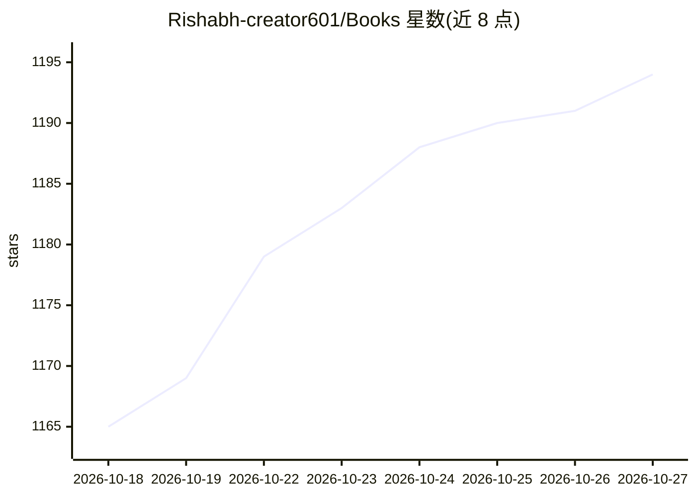

# Rishabh-creator601/Books

⭐ 1,194 · 推送 2026-06-27 · [GitHub](https://github.com/Rishabh-creator601/Books) · [官网](https://share.streamlit.io/user/rishabh-creator601) · 个人维护

**AI/ML 与编程领域的免费电子书聚合清单（200+ 本）**

个人维护的编程与 AI/ML 学习资源仓库：按计算机视觉、机器学习/深度学习、NLP、Python、强化学习、网络安全、数学统计、理论书籍等约 20 个分类收录 200+ 本电子书与参考资料，以 PDF 文件直接存放在仓库目录中，部分条目带 🌟 推荐标记。另附外部学习站点链接、Medium 上的 AIML 学习路线指南及各类学习路线图。无安装或运行方式，纯浏览/下载使用。

## 筛选速览

| 维度 | 判定 | 备注 |
|---|---|---|
| AI 角色 | `ai-knowledge` | 知识聚合/清单类 |
| 许可风险 | `none` | — |
| 部署形态 | `None` |  |
| 模型依赖 | — | README 未给出锁定关系 |
| 硬件要求 | — | 无带数字的原话,不猜 |
| 安装摩擦 | `low` | 无编译、无系统依赖或容器化 |
| 成熟度 | — | 结构信号不足 |

## 能力要点

- 200+ 本免费编程与 AI/ML 电子书按约 20 个分类组织
- 覆盖 CV、ML/DL、NLP、强化学习、Python、网络安全、数学统计等领域
- 附 AIML 入门路线指南（Medium 博客）与 2024 前后端路线图

## 适用场景

- 按分类查找机器学习与深度学习入门书籍
- 系统收集 Python、NLP、计算机视觉方向的参考资料
- 跟随 AIML 路线图规划自学顺序

## 场景标签

`精选清单` · 领域:学习与行业

## 证据(README 行号)

> L2: **A curated collection of books and references** for Computer Vision, Machine Learning, Deep Learning, NLP, Python, 
> L3: **A collection of more than 200+ programming ebooks at one place at no cost**

## 星数曲线

2026-10-18 1,165 → 2026-10-27 1,194（+29）

---
*卡片 v1 · prompt 1.4 · 生成 2026-10-21 · 置信度 high · 依据 README sha `453ff6a89bb7` · [字段定义](../../DATASET.md)*
