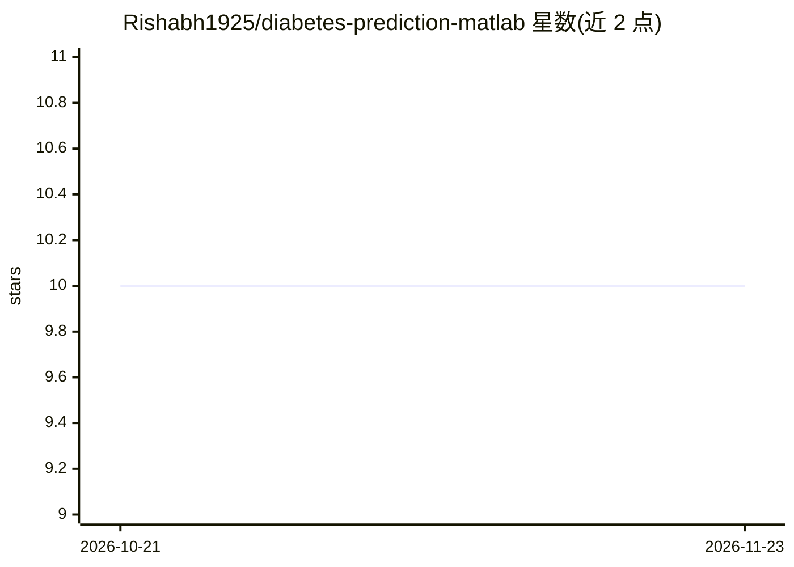

# Rishabh1925/diabetes-prediction-matlab

⭐ 10 · MATLAB · MIT · 推送 2026-01-10 · [GitHub](https://github.com/Rishabh1925/diabetes-prediction-matlab) · 个人维护

**面向普通用户的 MATLAB 糖尿病风险预测 GUI 工具**

基于 MATLAB 的糖尿病风险预测系统，使用 Pima Indian 数据集（768 条记录、9 个属性）训练 Random Forest（Bagged Trees）分类器，70% 数据训练。提供三页 GUI：录入用户信息、健康数据与家族史，自动由身高体重计算 BMI，按性别动态调整输入项，输出 High Risk / Low Risk 结果与建议。数据预处理包括缺失值均值替换与 Z-score 归一化。作者说明其为大学课程作业。

## 筛选速览

| 维度 | 判定 | 备注 |
|---|---|---|
| AI 角色 | `ai-native` | 本体是模型或模型工具 |
| 许可风险 | `permissive` | MIT |
| 部署形态 | `None` |  |
| 模型依赖 | — | README 未给出锁定关系 |
| 硬件要求 | — | 无带数字的原话,不猜 |
| 安装摩擦 | `low` | 无编译、无系统依赖或容器化 |
| 成熟度 | — | 结构信号不足 |

## 能力要点

- Random Forest（fitcensemble Bagged Ensemble）分类器预测糖尿病风险
- GUI 自动计算 BMI 并按性别动态调整输入字段
- 缺失值均值替换与 Z-score 归一化预处理

## 适用场景

- 用简单健康指标快速评估糖尿病风险
- 作为 MATLAB 机器学习课程作业参考
- 面向基层或远程地区的初筛场景示例

## 场景标签

 · 领域:医疗健康/机器学习

## 证据(README 行号)

> L3: This MATLAB-based Project implements a diabetes prediction system using machine learning and an intuitive graphical 
> L11: - **Random Forest (Bagged Trees Classifier)**
> L27: - **Random Forest (Bagged Ensemble)** classifier chosen for its robustness with tabular data.

## 星数曲线

2026-10-21 10 → 2026-11-23 10（+0）

---
*卡片 v1 · prompt 1.4 · 生成 2026-11-20 · 置信度 high · 依据 README sha `bdb4416a496d` · [字段定义](../../DATASET.md)*
