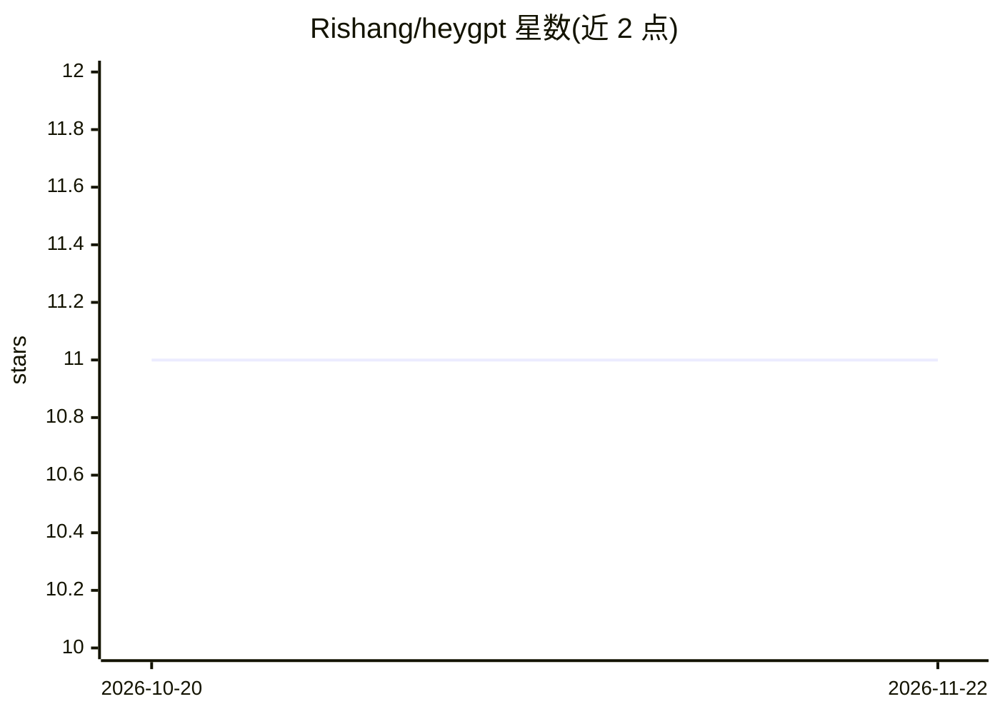

# Rishang/heygpt

⭐ 11 · Python · GPL-3.0 · 推送 2025-11-26 · [GitHub](https://github.com/Rishang/heygpt) · [官网](https://pypi.org/project/heygptcli/) · 个人维护

**基于模板提示词的命令行与 Web UI 文本生成工具**

通过 litellm 调用多家 LLM 的 CLI 工具，同时提供 Streamlit Web UI 与 FastAPI 接口三种运行形态。核心机制是 YAML 格式的预置提示词模板：用户用 fzf 交互选择模板后输入查询，工具按模板生成结果；支持本地或远程 YAML 提示词文件、`--model` 切换模型、`--no-prompt` 直接提问、标准输入输出管道，以及 `wisper` 音频转文字后接入 `ask` 的组合用法。使用前需配置所用 LLM 提供方的 API key。

## 筛选速览

| 维度 | 判定 | 备注 |
|---|---|---|
| AI 角色 | `ai-native` | 本体是模型或模型工具 |
| 许可风险 | `viral` | GPL-3.0 |
| 部署形态 | `library` | 以包/库形式分发 |
| 模型依赖 | — | README 未给出锁定关系 |
| 硬件要求 | — | 无带数字的原话,不猜 |
| 安装摩擦 | `low` | 无编译、无系统依赖或容器化 |
| 成熟度 | — | 结构信号不足 |

## 能力要点

- CLI、Streamlit Web UI、FastAPI 三种运行形态
- YAML 格式提示词模板，支持本地文件与远程 URL
- 经 litellm 支持多家 LLM 提供方，可指定模型
- fzf 交互式模板选择与管道输入输出

## 适用场景

- 在命令行用保存的提示词模板快速处理文本（如语法修正）
- 将音频转写输出接入 LLM 进一步处理
- 在本地起 Web UI 或 API 服务使用提示词模板

## 场景标签

`提示工程` `AI 写作` · 领域:Agent 开发

## 证据(README 行号)

> L5: A simple command line tool to generate text using any LLM (via litellm) based on ready made templated prompts.
> L40: You will need an API key from your LLM provider to use `heygpt`. Supported providers include OpenAI, Anthropic, Goo

## 星数曲线

2026-10-20 11 → 2026-11-22 11（+0）

---
*卡片 v1 · prompt 1.4 · 生成 2026-11-18 · 置信度 high · 依据 README sha `75f665195cd4` · [字段定义](../../DATASET.md)*
