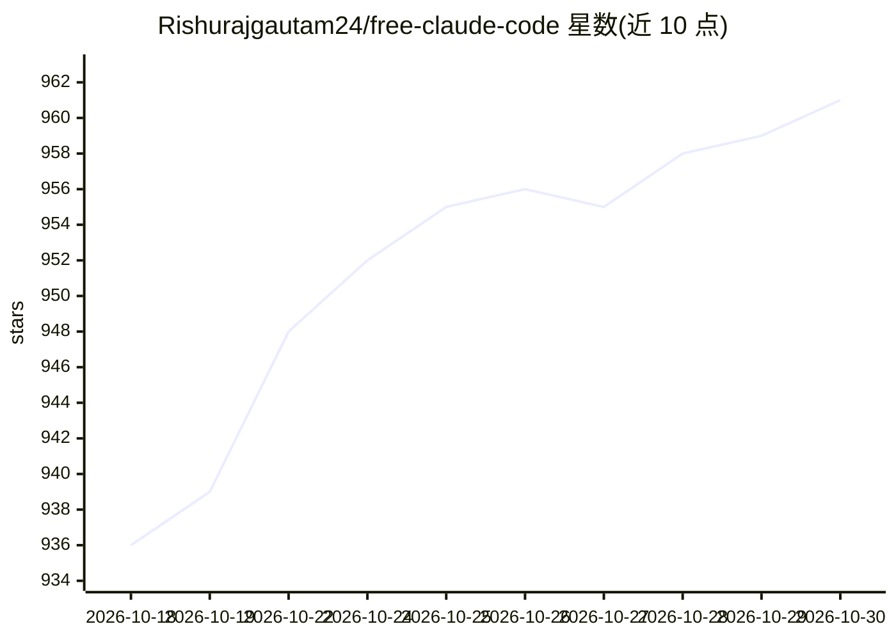

# Rishurajgautam24/free-claude-code

⭐ 961 · Python · MIT · 推送 2026-10-17 · [GitHub](https://github.com/Rishurajgautam24/free-claude-code) · 个人维护

**免费使用 Claude Code 的本地代理：转发请求到第三方或本地模型**

轻量代理服务器，接收 Claude Code CLI / VSCode 扩展发出的 Anthropic API 请求，转发到 NVIDIA NIM、OpenRouter、LM Studio、Ollama、Groq 等 10 类提供方或任意 OpenAI 兼容端点，无需 Anthropic API key。通过两个环境变量即可接入，不改 Claude Code 本体。支持按 Opus/Sonnet/Haiku 分别映射模型与提供方、逗号分隔的失败回退链、思考标签转换为原生 thinking 块、图像输入与本地拦截 5 类琐碎请求以节省配额。另含 Discord/Telegram 远程编码 bot、诊断脚本 doctor.py 与 fzf 模型选择器。以 MIT 许可提供，需 Python/uv 从源码运行，或用 Docker Compose 部署；代理默认仅监听 localhost，可设 PROXY_AUTH_TOKEN 做远程访问认证。

## 筛选速览

| 维度 | 判定 | 备注 |
|---|---|---|
| AI 角色 | `ai-ecosystem` | LLM/agent 周边工具 |
| 许可风险 | `permissive` | MIT |
| 部署形态 | `self-host` | docker 或自建部署 |
| 模型依赖 | local-ok | 支持本地模型 |
| 硬件要求 | — | 无带数字的原话,不猜 |
| 安装摩擦 | `low` | 无编译、无系统依赖或容器化 |
| 成熟度 | — | 结构信号不足 |

## 能力要点

- 将 Claude Code 的 Anthropic API 请求代理到 10 类提供方（NIM/OpenRouter/LM Studio/Ollama 等）
- 按 Opus/Sonnet/Haiku 做逐模型路由与逗号分隔的失败回退链
- <think> 标签与 reasoning_content 转换为原生 Claude thinking 块
- 本地拦截 5 类琐碎请求以节省配额与延迟；提供 doctor.py 诊断脚本

## 适用场景

- 在没有 Anthropic API key 的情况下用第三方或本地模型驱动 Claude Code
- 在 Claude Code 内通过 /model 选择器或 claude-pick 切换后端模型
- 用 LM Studio 或 Ollama 完全本地运行 Claude Code
- 通过 Discord/Telegram 远程发起编码会话

## 场景标签

`模型网关` · 领域:Agent 开发

## 证据(README 行号)

> L13: A lightweight proxy that routes Claude Code's Anthropic API calls to **NVIDIA NIM** (40 req/min free), **OpenRouter
> L267: │  Claude Code    │───────>│  Free Claude Code    │───────>│  LLM Provider    │
> L272: - **Transparent proxy**: Claude Code sends standard Anthropic API requests to the proxy server

## 星数曲线

2026-10-18 936 → 2026-10-30 961（+25）

---
*卡片 v1 · prompt 1.4 · 生成 2026-10-21 · 置信度 high · 依据 README sha `1b8aa1e00f00` · [字段定义](../../DATASET.md)*
