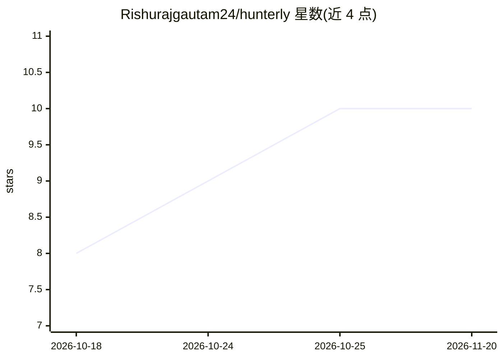

# Rishurajgautam24/hunterly

⭐ 10 · Python · MIT · 推送 2026-10-11 · [GitHub](https://github.com/Rishurajgautam24/hunterly) · 个人维护

**求职者用的招聘经理邮箱查找与本地 AI 外联工具**

Chrome 侧边栏扩展加本地 Python 后端：在 LinkedIn 个人页一键保存联系人，按约 30 种命名规则生成候选邮箱并通过公司邮件服务器验证（不发信），随后用 Ollama 本地模型生成首次外联草稿，经 Gmail 手动发送并跟踪第 4/9 天跟进、回复与退信。数据存于本机 `.hunterly` 目录；可选接入 Hunter（免费额度）与 Gmail API；每日保存与发送数量内置限制。

## 筛选速览

| 维度 | 判定 | 备注 |
|---|---|---|
| AI 角色 | `ai-enhanced` | 去掉 AI 部分产品仍成立 |
| 许可风险 | `permissive` | MIT |
| 部署形态 | `desktop` | 安装包/桌面程序 |
| 模型依赖 | local-ok | 支持本地模型 |
| 硬件要求 | — | 无带数字的原话,不猜 |
| 安装摩擦 | `low` | 无编译、无系统依赖或容器化 |
| 成熟度 | `idea` | |

## 能力要点

- 约 30 种邮箱命名模式生成候选并用公司邮件服务器验证（不发送邮件）
- Ollama 本地模型生成外联草稿，不可用时退回模板填充
- 第 4/9 天跟进、3 条消息上限、退信切换地址与勿扰名单的跟踪流水线
- 端口 25 被封时可将验证器部署到云 VM 或接入 Hunter API

## 适用场景

- 求职时查找并验证招聘经理的工作邮箱
- 用本地模型起草个性化首次外联邮件
- 跟踪外联进度、跟进提醒与退信处理

## 场景标签

`AI 写作` · 领域:内容生成

## 证据(README 行号)

> L6: A Chrome extension plus a small local backend. Free, open source, and private: your data stays on your computer.
> L22: 3. **Draft**: a short, personal first message, written by a local AI model (Ollama) on your machine. You review it 
> L38: |Drafts|Local LLM through Ollama (private, free). Falls back to a fill-in template if Ollama isn't running. Drafts 

## 星数曲线

2026-10-18 8 → 2026-11-20 10（+2）

---
*卡片 v1 · prompt 1.4 · 生成 2026-11-20 · 置信度 high · 依据 README sha `948545c01886` · [字段定义](../../DATASET.md)*
