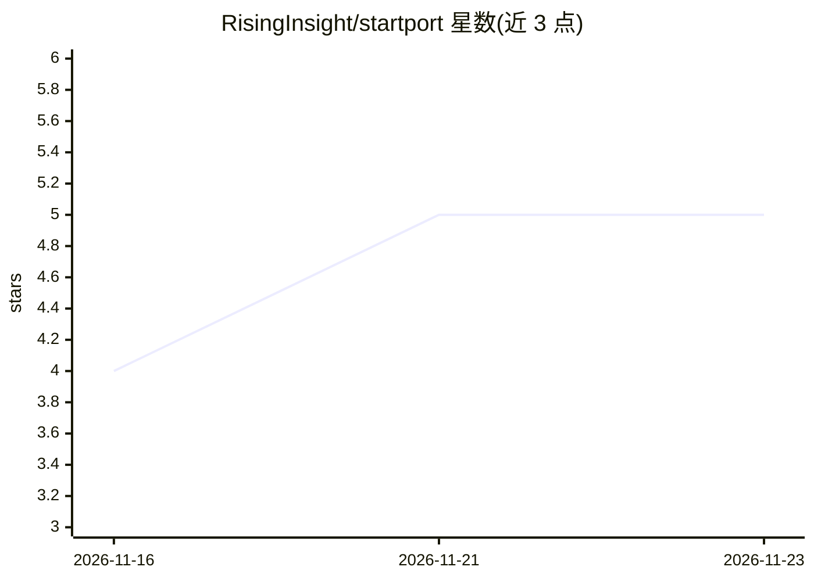

# RisingInsight/startport

⭐ 5 · Go · MIT · 推送 2026-11-08 · [GitHub](https://github.com/RisingInsight/startport) · 个人维护 · 中文 README

**自托管 AI 凭证网关：统一三种协议接入多家平台模型**

以 Go 编写的自托管单二进制网关，为 AI 编程工具提供本地统一端点：三个入站协议面（OpenAI Chat Completions / Anthropic Messages / OpenAI Responses）翻译成四种出站协议，并把多平台账号收进统一凭证池，提供签到、保活、熔断冷却、会话粘性、用量账本等治理能力，附带 Web 面板。面向同时使用多个 AI 编程工具的开发者与小团队。默认仅监听 127.0.0.1，定位为管理自有凭证的私有入口，反对转售与账号共享。

## 筛选速览

| 维度 | 判定 | 备注 |
|---|---|---|
| AI 角色 | `ai-ecosystem` | LLM/agent 周边工具 |
| 许可风险 | `permissive` | MIT |
| 部署形态 | `desktop` | 安装包/桌面程序 |
| 模型依赖 | locked-api |  |
| 硬件要求 | — | 无带数字的原话,不猜 |
| 安装摩擦 | `low` | 无编译、无系统依赖或容器化 |
| 成熟度 | `idea` | |

## 能力要点

- 三入站 × 四出站协议双向转换，换后端只改 model 名
- 多平台凭证池：签到、保活、熔断冷却、自动 failover
- Web 面板 8 个视图：账号、用量、日志、配置等
- 工具调用还原与 Responses 事件流按官方序列输出

## 适用场景

- 多个 AI 编程工具指向同一个本地端点统一管理
- 把多个平台额度收拢到一个端点统一看用量
- 在自建评测环境中对比多家后端表现

## 场景标签

`模型网关` · 领域:Agent 开发

## 证据(README 行号)

> L22: |**是什么**|自托管网关：把客户端说的三种协议翻译成上游说的四种协议，并把多家平台的凭证收进一个池子统一治理|
> L39: 一句话：**它是 AI 开发工作流里的一块连接件**——不生产模型，只负责让"工具"和"供给"对得上。
> L174: **准备**：Docker（或直接跑单文件二进制）；从源码构建需要 Go ≥ 1.22。

## 星数曲线

2026-11-16 4 → 2026-11-23 5（+1）

---
*卡片 v1 · prompt 1.4 · 生成 2026-11-21 · 置信度 high · 依据 README sha `20be97e18321` · [字段定义](../../DATASET.md)*
