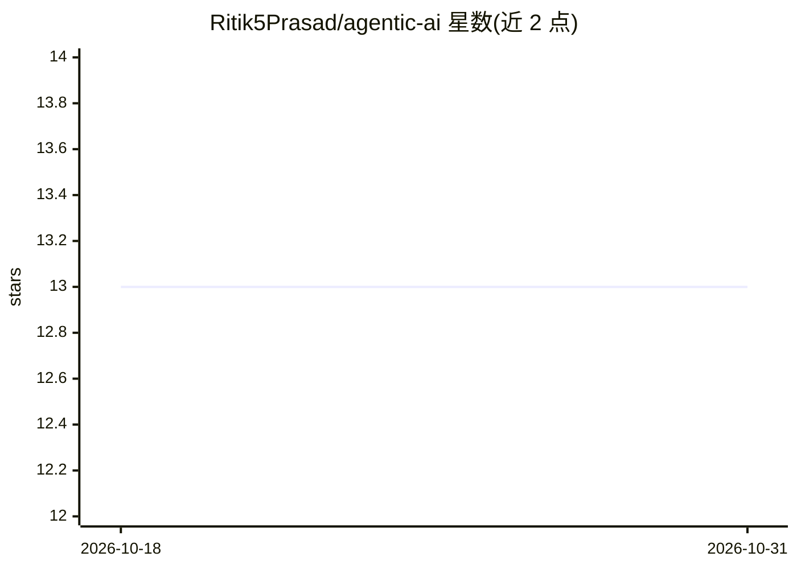

# Ritik5Prasad/agentic-ai

⭐ 13 · Python · 推送 2026-06-20 · [GitHub](https://github.com/Ritik5Prasad/agentic-ai) · [官网](https://youtu.be/6lr2UNYNtlY) · 个人维护

**多智能体协作的文档问答聊天系统（含课程式从零构建）**

由监督、搜索、摘要三个 agent 协作的 AI 聊天系统：用户上传文档、提问并获得回答。后端用 FastAPI、LangChain、Redis、Elasticsearch 与 HuggingFace 模型，前端为 Next.js 15 + TypeScript + Tailwind。启动方式为 podman-compose 拉起 Redis/Elasticsearch，分别以 pip 和 npm 安装前后端依赖后本地运行，需自行配置 API keys。同时定位为一门从零构建多模型 agent 的课程。

## 筛选速览

| 维度 | 判定 | 备注 |
|---|---|---|
| AI 角色 | `ai-native` | 本体是模型或模型工具 |
| 许可风险 | `none` | — |
| 部署形态 | `library` | 以包/库形式分发 |
| 模型依赖 | — | README 未给出锁定关系 |
| 硬件要求 | — | 无带数字的原话,不猜 |
| 安装摩擦 | `low` | 无编译、无系统依赖或容器化 |
| 成熟度 | — | 结构信号不足 |

## 能力要点

- 监督/搜索/摘要三 agent 分工协作
- 支持文档上传与基于 Elasticsearch 的问答
- 覆盖文档摄取、搜索、记忆与 agent 工作流
- 前后端分离：FastAPI 后端 + Next.js 15 前端

## 适用场景

- 搭建可上传文档并问答的多 agent 聊天应用
- 学习用 LangGraph/LangChain 从零构建 agent 工作流
- 作为 FastAPI + Redis + Elasticsearch 的 AI 应用参考实现

## 场景标签

`多智能体` `文档问答` `教程课程` · 领域:Agent 开发

## 证据(README 行号)

> L11: An AI chat system with multiple agents working together - one supervises, one searches, and one summarizes. Upload 
> L17: - LangChain

## 星数曲线

2026-10-18 13 → 2026-10-31 13（+0）

---
*卡片 v1 · prompt 1.4 · 生成 2026-10-31 · 置信度 high · 依据 README sha `6559c151ff37` · [字段定义](../../DATASET.md)*
