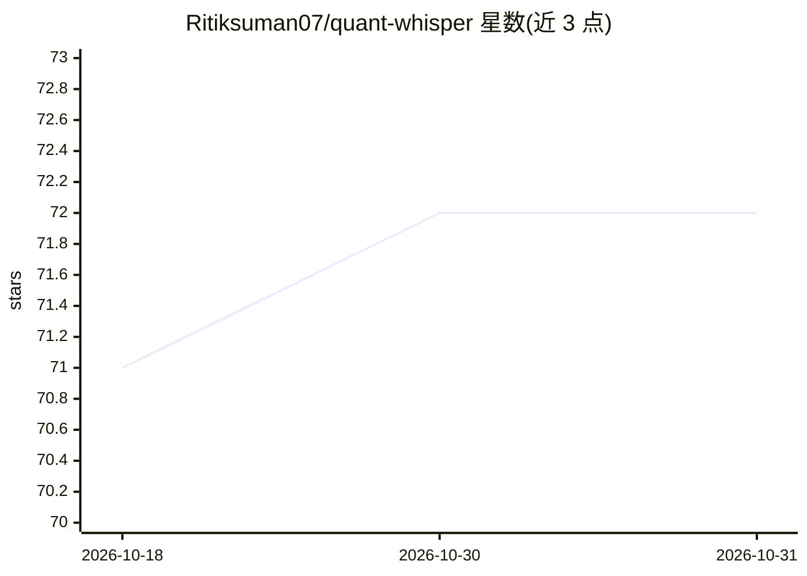

# Ritiksuman07/quant-whisper

⭐ 72 · Go · MIT · 推送 2026-06-01 · [GitHub](https://github.com/Ritiksuman07/quant-whisper) · 个人维护

**终端原生的 Go 算法交易引擎，本地 LLM 生成交易决策**

基于 Go 的命令行算法交易执行引擎：通过 Ollama（默认 qwen3:0.8b）进行本地 LLM 推理，以严格 JSON 协议输出 BUY/SELL/HOLD 决策及置信度与理由；支持 Zerodha/Dhan/Interactive Brokers 的载荷适配层，提供纸面/实盘模式、SQLite 持久化交易与 P&L 历史、Bubble Tea 实时仪表盘、实盘执行墙（置信度阈值、回撤熔断、频率与仓位限制）及纯文本策略注入。市场数据与订单执行当前为本地模拟。可选 OpenAI/Anthropic/DeepSeek 云端回退。

## 筛选速览

| 维度 | 判定 | 备注 |
|---|---|---|
| AI 角色 | `ai-native` | 本体是模型或模型工具 |
| 许可风险 | `permissive` | MIT |
| 部署形态 | `None` |  |
| 模型依赖 | local-ok | 支持本地模型 |
| 硬件要求 | — | 无带数字的原话,不猜 |
| 安装摩擦 | `low` | 无编译、无系统依赖或容器化 |
| 成熟度 | — | 结构信号不足 |

## 能力要点

- 本地 Ollama LLM 推理输出严格 JSON 交易决策（默认 qwen3:0.8b）
- 实盘执行墙：置信度阈值、日回撤 kill-switch、交易频率与仓位上限
- Zerodha/Dhan/IB 券商适配层与 SQLite 交易/P&L 持久化
- 纯文本策略文件注入运行时提示词

## 适用场景

- 在本地跑纸面交易回测 LLM 驱动的策略
- 通过终端仪表盘监控决策流、交易与 P&L
- 在不依赖云端的前提下实验本地模型做交易决策

## 场景标签

`金融量化` · 领域:学习与行业

## 证据(README 行号)

> L3: Terminal-native algorithmic trading execution engine built in Go with local-first AI inference, deterministic execut
> L13: - Local LLM processing via Ollama (`qwen3:0.8b` default).

## 星数曲线

2026-10-18 71 → 2026-10-31 72（+1）

---
*卡片 v1 · prompt 1.4 · 生成 2026-10-24 · 置信度 high · 依据 README sha `71a80a74410a` · [字段定义](../../DATASET.md)*
