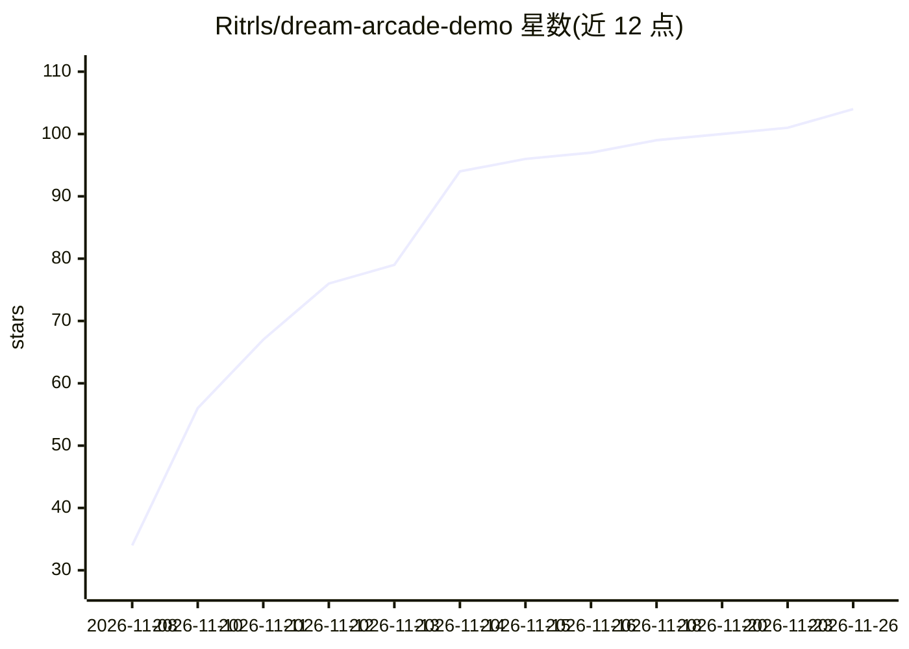

# Ritrls/dream-arcade-demo

⭐ 104 · HTML · MIT · 推送 2026-11-14 · [GitHub](https://github.com/Ritrls/dream-arcade-demo) · [官网](https://ritrls.github.io/dream-arcade-demo/) · 个人维护 · 中文 README

**用自然语言生成单位的浏览器小游戏演示（塔防/RTS/矿场）**

纯前端 JavaScript 浏览器游戏演示，含三种玩法模板：五路线路防守、150 秒口袋 RTS、放置型增量矿场。核心 AI 功能是自然语言造单位：用户在网页填入自己的 RunningHub API Key，文本模型生成名称与属性技能，图片模型绘制单位素材，经边界检查与费用平衡后进入对局；游戏规则由固定模板提供，AI 不生成可执行代码。内置预设单位与美术，无需 Key 即可试玩；自建单位存于本地浏览器，可导出离线游戏文件。零第三方运行依赖，Node.js 22+ 运行 npm run dev 即可本地启动。

## 筛选速览

| 维度 | 判定 | 备注 |
|---|---|---|
| AI 角色 | `ai-enhanced` | 去掉 AI 部分产品仍成立 |
| 许可风险 | `permissive` | MIT |
| 部署形态 | `library` | 以包/库形式分发 |
| 模型依赖 | — | README 未给出锁定关系 |
| 硬件要求 | — | 无带数字的原话,不猜 |
| 安装摩擦 | `low` | 无编译、无系统依赖或容器化 |
| 成熟度 | — | 结构信号不足 |

## 能力要点

- 自然语言生成单位属性、技能与专属美术，接入 RunningHub API
- 三种可玩模板：线路防守、口袋 RTS、增量矿场
- 生成属性参与真实战斗与生产模拟，费用自动平衡
- 自建单位本地保存，可导出含素材与进度的离线游戏文件

## 适用场景

- 用一句话创造自定义单位并带入塔防或 RTS 对局
- 无需注册 API Key，用预设 AI 成品模板直接试玩
- 把自建阵容打包成离线文件分享给朋友

## 场景标签

`图像生成` · 领域:内容生成

## 证据(README 行号)

> L37: 1. 在网页连接自己的 RunningHub API Key。
> L44: 目前技能库为**稳定攻击、冰霜减速、三击爆发、护盾减伤**。游戏规则和技能由固定模板提供，AI 不生成任意可执行代码。

## 星数曲线

2026-11-08 34 → 2026-11-26 104（+70）

---
*卡片 v1 · prompt 1.4 · 生成 2026-11-17 · 置信度 mid · 依据 README sha `b98ba927162a` · [字段定义](../../DATASET.md)*
