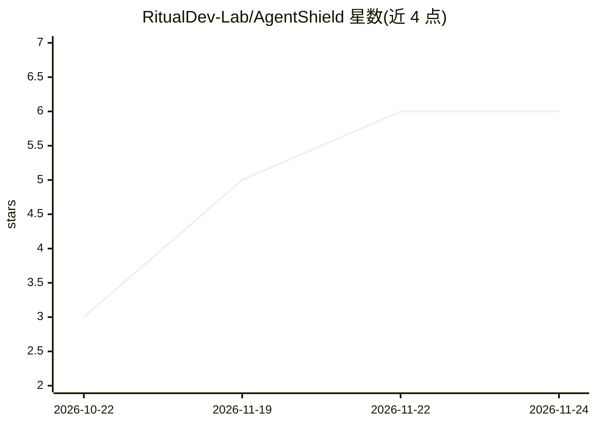

# RitualDev-Lab/AgentShield

⭐ 6 · TypeScript · Apache-2.0 · 推送 2026-11-19 · [GitHub](https://github.com/RitualDev-Lab/AgentShield) · [官网](https://ritualdev.in/agentshield) · 组织维护

**为自主 AI agent 提供凭据防泄漏与命令拦截的安全层**

面向 Claude Code、Cursor 等自主编码 agent 的本地安全防火墙：实时拦截 shell 命令（阻断读取 .env、printenv 等）、对 stdout/stderr 流式脱敏、生成 macOS Seatbelt/Linux Landlock/Windows AppContainer 沙箱配置、提供 git pre-commit 与 CI 检测门禁，并用确定性代理令牌替代明文密钥。零运行时依赖、默认全本地运行，通过 npx 提供 CLI，另含 Node/Python/Go/Rust SDK 及语言无关 sidecar。README 说明用户态命令检查属纵深防御而非 OS 内核安全边界。

## 筛选速览

| 维度 | 判定 | 备注 |
|---|---|---|
| AI 角色 | `ai-ecosystem` | LLM/agent 周边工具 |
| 许可风险 | `permissive` | Apache-2.0 |
| 部署形态 | `library` | 以包/库形式分发 |
| 模型依赖 | — | README 未给出锁定关系 |
| 硬件要求 | — | 无带数字的原话,不猜 |
| 安装摩擦 | `low` | 无编译、无系统依赖或容器化 |
| 成熟度 | — | 结构信号不足 |

## 能力要点

- 命令防火墙拦截混淆形式的环境变量/密钥读取
- 跨 TCP/stdio 分块的流式脱敏（正则 + Shannon 熵）
- 按平台生成并校验 OS 沙箱配置，支持 fail-closed 隔离模式
- 提供 Node/Python/Go/Rust SDK 与 JSON-RPC 2.0 sidecar

## 适用场景

- 防止编码 agent 将 .env 密钥送入第三方模型 API
- git 提交与 CI 前拦截引入凭据的代码变更
- 为多语言 agent 工程统一接入本地脱敏与命令管控

## 场景标签

`网络安全` · 领域:学习与行业

## 证据(README 行号)

> L34: AgentShield intercepts commands and stdout/stderr **before** credentials leave your machine:
> L155: ## 🤖 AI Agent Ecosystem Integrations
> L217: |**Node.js / TypeScript**|`@ritualdev-lab/agentshield`|Node 20+, Cursor, Claude Code, MCP|In-process native TypeSc

## 星数曲线

2026-10-22 3 → 2026-11-24 6（+3）

---
*卡片 v1 · prompt 1.4 · 生成 2026-11-21 · 置信度 high · 依据 README sha `979f4be353cd` · [字段定义](../../DATASET.md)*
