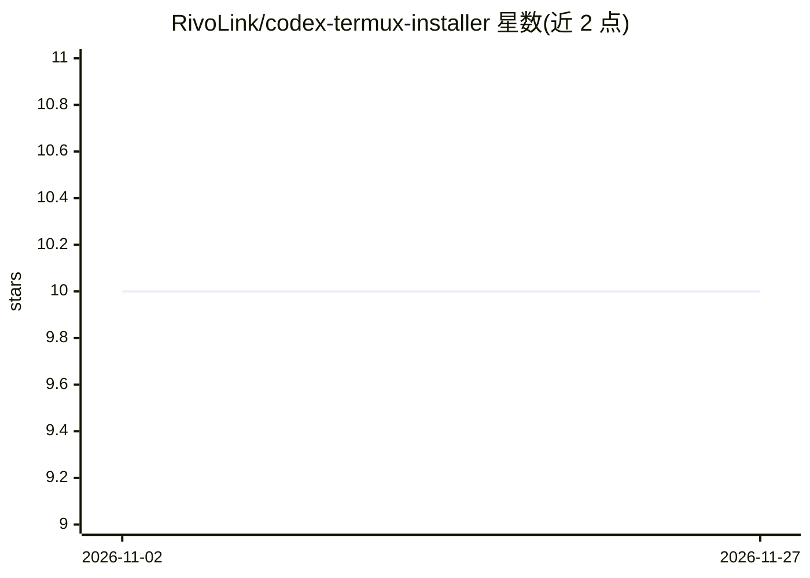

# RivoLink/codex-termux-installer

⭐ 10 · Shell · MIT · 推送 2026-01-08 · [GitHub](https://github.com/RivoLink/codex-termux-installer) · 个人维护

**一条命令在 Android/Termux 安装 OpenAI Codex CLI**

一个 shell 安装脚本，通过 curl 一条命令在 Termux 环境安装或更新 OpenAI Codex CLI。脚本自动安装 rust/openssl/pkg-config 依赖，为低内存设备配置专用 cargo 编译 profile（关闭 LTO、降低优化级别），从 GitHub 获取最新 rust-v* 稳定标签，用 cargo 从源码编译并安装 codex-cli，最后创建符号链接。安装后需用 OpenAI 账号执行 codex login 认证；重复运行同一命令可更新。限制：需 Termux on Android 与网络连接，低端设备编译约需 30 分钟。

## 筛选速览

| 维度 | 判定 | 备注 |
|---|---|---|
| AI 角色 | `ai-ecosystem` | LLM/agent 周边工具 |
| 许可风险 | `permissive` | MIT |
| 部署形态 | `None` |  |
| 模型依赖 | — | README 未给出锁定关系 |
| 硬件要求 | — | 无带数字的原话,不猜 |
| 安装摩擦 | `low` | 无编译、无系统依赖或容器化 |
| 成熟度 | — | 结构信号不足 |

## 能力要点

- 单条 curl 命令完成安装或更新
- 针对低内存设备的定制 cargo 编译 profile（lto=off 等）
- 自动检测 GitHub 最新 rust-v* 稳定标签并源码编译
- 自动创建 codex 二进制的符号链接

## 适用场景

- 在 Android 手机的 Termux 上安装 Codex CLI
- 低端 Android 设备内存不足导致默认编译失败时的替代安装方式
- 后续更新 Termux 中的 Codex CLI 版本

## 场景标签

`编码 Agent` · 领域:编码与开发

## 证据(README 行号)

> L3: Install or update OpenAI Codex CLI on Termux with a single command.
> L21: 1. **Installs dependencies** - `rust`, `openssl`, `pkg-config` via pkg
> L24: 4. **Builds and installs codex-cli** - using cargo with the `termux` profile

## 星数曲线

2026-11-02 10 → 2026-11-27 10（+0）

---
*卡片 v1 · prompt 1.4 · 生成 2026-11-20 · 置信度 high · 依据 README sha `04eaf6d75a50` · [字段定义](../../DATASET.md)*
