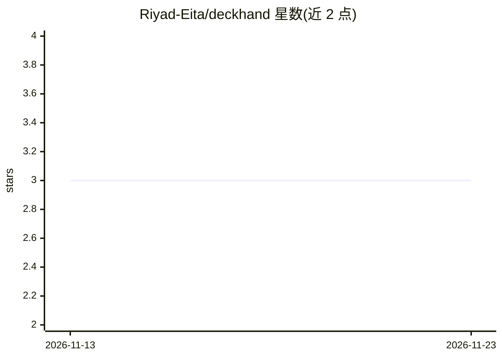

# Riyad-Eita/deckhand

⭐ 3 · Swift · 推送 2026-11-16 · [GitHub](https://github.com/Riyad-Eita/deckhand) · [官网](https://github.com/users/Riyad-Eita/projects/3) · 组织维护

**把服务器、终端与 AI 编码代理装进 iPhone 的运维客户端**

Deckhand 是一款 iOS 应用，通过 QR 配对或密钥建立 SSH 连接，在手机上提供 xterm 兼容终端（会话驻留 tmux/screen）。AI 部分以三种方式接入：自带 key 时 agent 循环在手机运行、工具经 SSH 在服务器执行，改前需确认；或在服务器上运行 Codex/Claude Code 并在应用内安装、登录与跟踪；MCP 服务器可从目录选取并一键同步。此外包含服务器面板（进程/日志/Docker/Git）、故障排查 agent、restic 备份与部署回滚。需 iOS 26+，Beta 阶段，无 Deckhand 后端。

## 筛选速览

| 维度 | 判定 | 备注 |
|---|---|---|
| AI 角色 | `ai-ecosystem` | LLM/agent 周边工具 |
| 许可风险 | `none` | — |
| 部署形态 | `None` |  |
| 模型依赖 | locked-api |  |
| 硬件要求 | — | 无带数字的原话,不猜 |
| 安装摩擦 | `medium` | 含编译或系统依赖之一 |
| 成熟度 | `idea` | |

## 能力要点

- agent 循环在手机、工具经 SSH 在服务器执行，破坏性命令前强制确认
- 应用内安装并跟踪服务器上的 Codex / Claude Code 会话
- MCP 服务器目录（GitHub、Hugging Face、Stripe、Playwright 等）一键同步
- on-device Whisper large-v3 语音输入，无账号无追踪

## 适用场景

- 手机上修复服务器、查看部署状态并保持 SSH 会话
- 让 AI 编码 agent 在自己的服务器代码上工作
- 通过 MCP 连接 GitHub/Hugging Face 等服务辅助运维
- 网站宕机时由只读 agent 找因并一键应用修复

## 场景标签

`编码 Agent` `语音识别` · 领域:编码与开发

## 证据(README 行号)

> L37: - **Agents on your server**
> L41:  - *Your subscription*: run **Codex** or **Claude Code** on your server and follow every step natively in the app.
> L44: - **Connections (MCP)** — pick from a catalog (GitHub, Hugging Face, Stripe, Playwright, docs servers …) or add any

## 星数曲线

2026-11-13 3 → 2026-11-23 3（+0）

---
*卡片 v1 · prompt 1.4 · 生成 2026-11-22 · 置信度 high · 依据 README sha `02541b82c48e` · [字段定义](../../DATASET.md)*
