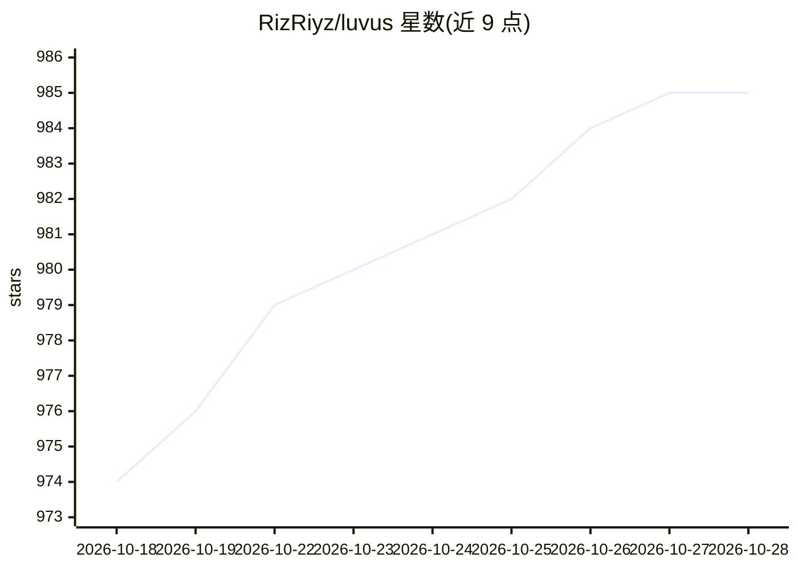

# RizRiyz/luvus

⭐ 985 · Rust · Apache-2.0 · 推送 2026-10-21 · [GitHub](https://github.com/RizRiyz/luvus) · [官网](https://luvus.dev) · 个人维护

**面向 AI 编码代理的终端任务控制台/多路复用器**

用 Rust 编写的跨平台终端工作区，用于运行与编排 AI 编码代理：提供持久工作区、分屏与标签管理、后台服务器保存会话状态。可自动检测代理并显示 blocked/working/done/idle 状态、token、成本与上下文用量；支持启动、消息、恢复及带上下文 fork Claude/Codex/Pi/OMP 等会话；含 Git/GitHub 面板、worktree 任务编排、SSH 远程机器、可选浏览器客户端 Luvus Web 与模块扩展机制。通过安装脚本、Homebrew 或 PowerShell 安装。

## 筛选速览

| 维度 | 判定 | 备注 |
|---|---|---|
| AI 角色 | `ai-ecosystem` | LLM/agent 周边工具 |
| 许可风险 | `permissive` | Apache-2.0 |
| 部署形态 | `library` | 以包/库形式分发 |
| 模型依赖 | — | README 未给出锁定关系 |
| 硬件要求 | — | 无带数字的原话,不猜 |
| 安装摩擦 | `low` | 无编译、无系统依赖或容器化 |
| 成熟度 | — | 结构信号不足 |

## 能力要点

- 自动检测 17+ 种编码代理并显示实时状态、token、成本与上下文用量
- 带上下文 fork 与恢复 Claude、Grok、Codex、Pi、OMP 会话
- worktree 任务编排：任务队列、路径租约、质量门与合并
- 模块扩展与 UHP 1.0 通用 Harness 协议

## 适用场景

- 在同一终端中并行运行并监控多个 AI 编码代理
- 跨本地与 SSH 远程机器管理持久代理工作区
- 用 worktree 协调多代理依赖任务并合并完成的工作

## 场景标签

`Agent 框架` · 领域:Agent 开发

## 证据(README 行号)

> L5: **Mission control for your AI coding agents.**
> L25: - **Agent awareness:** Detect supported agents automatically and show blocked,
> L90: Run Luvus in a project, split a pane, and start an agent. Luvus detects supported

## 星数曲线

2026-10-18 974 → 2026-10-28 985（+11）

---
*卡片 v1 · prompt 1.4 · 生成 2026-10-21 · 置信度 high · 依据 README sha `ccb89af9ae9f` · [字段定义](../../DATASET.md)*
