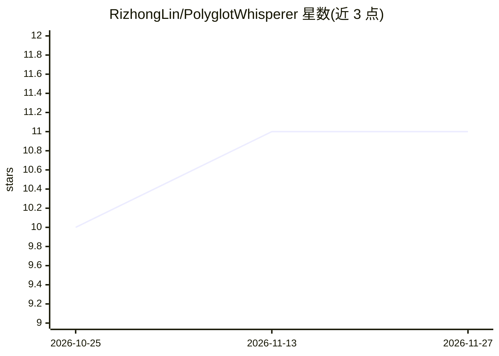

# RizhongLin/PolyglotWhisperer

⭐ 11 · Python · MIT · 推送 2026-06-10 · [GitHub](https://github.com/RizhongLin/PolyglotWhisperer) · 个人维护

**把视频转成语言学习工具：转录+翻译+生词+双字幕播放器**

一条视频处理管线：对任意视频或链接做语音转录、转录修正、目标语言翻译、词汇难度与 CEFR 等级分析，导出双语字幕、PDF、EPUB 及 Anki CSV；配套 Web 界面提供双字幕播放、点击查词存为闪卡，并按 FSRS 算法间隔复习，可由 LLM 自动补充词典原形、释义、IPA、语法注释与例句。以 Python CLI（pgw）与 FastAPI/React Web 应用分发，支持 Docker 部署与 Postgres。需 Python 3.12+、uv、ffmpeg；转录可走云端 API，无需 GPU。

## 筛选速览

| 维度 | 判定 | 备注 |
|---|---|---|
| AI 角色 | `ai-native` | 本体是模型或模型工具 |
| 许可风险 | `permissive` | MIT |
| 部署形态 | `self-host` | docker 或自建部署 |
| 模型依赖 | local-ok | 支持本地模型 |
| 硬件要求 | — | 无带数字的原话,不猜 |
| 安装摩擦 | `low` | 无编译、无系统依赖或容器化 |
| 成熟度 | — | 结构信号不足 |

## 能力要点

- 转录→修正→翻译→词汇分析的完整管线，导出双语字幕/PDF/EPUB/Anki CSV
- Web 播放器双字幕、点击查词并保存为闪卡，FSRS 间隔复习
- LLM 自动丰富闪卡：词典原形、母语释义、IPA、语法注释与例句
- 支持 Docker Compose（含 Postgres）与每用户加密 API 密钥

## 适用场景

- 把外语视频变成带双字幕的学习材料
- 从视频中收集生词并做间隔重复记忆
- 为已有字幕文件批量生成译文

## 场景标签

`语音识别` · 领域:感知与多模态

## 证据(README 行号)

> L12: 1. **Transcribe** the speech into subtitles (in the original language)
> L15: 4. **Analyse vocabulary** — which words are rare, which are common, your CEFR level
> L18: Then open the web interface and **play the video with dual subtitles**, click any word to see its difficulty and sa

## 星数曲线

2026-10-25 10 → 2026-11-27 11（+1）

---
*卡片 v1 · prompt 1.4 · 生成 2026-11-18 · 置信度 high · 依据 README sha `a48a7933e7f2` · [字段定义](../../DATASET.md)*
