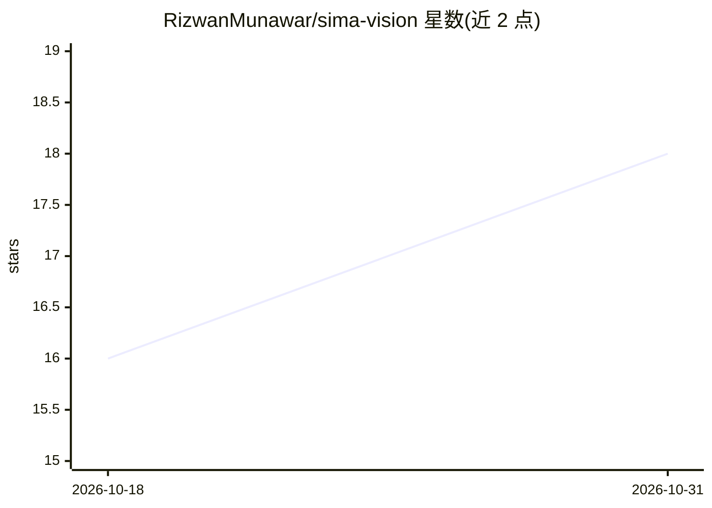

# RizwanMunawar/sima-vision

⭐ 18 · Python · Apache-2.0 · 推送 2026-10-28 · [GitHub](https://github.com/RizwanMunawar/sima-vision) · [官网](https://rizwanai.com) · 个人维护

**SiMa Modalix 开发板上运行 YOLO 视觉应用的 CLI 工具集**

面向 SiMa.ai Modalix DevKit 3.0 的计算机视觉命令行工具集，提供四个应用：目标检测（detect）、实例分割（segment，支持背景/实例模糊与匿名化）、跌倒检测（fall，含确认时长与再触发机制）、零售分析（ret-analytics，购物车商品识别与估价汇总）。首个运行自动拉取预训练 YOLO26 模型包与演示视频，输出标注视频。需 DevKit 硬件与 Python 3.10+；自定义模型需在 PC 端经 Palette Model SDK 容器（x86 Docker）编译约 30 分钟。提供 push/pull 命令在 PC 与板卡间传文件。

## 筛选速览

| 维度 | 判定 | 备注 |
|---|---|---|
| AI 角色 | `ai-native` | 本体是模型或模型工具 |
| 许可风险 | `permissive` | Apache-2.0 |
| 部署形态 | `library` | 以包/库形式分发 |
| 模型依赖 | — | README 未给出锁定关系 |
| 硬件要求 | — | 无带数字的原话,不猜 |
| 安装摩擦 | `low` | 无编译、无系统依赖或容器化 |
| 成熟度 | — | 结构信号不足 |

## 能力要点

- 四个应用共用一条流水线：detect / segment / fall / ret-analytics
- 首次运行自动拉取 YOLO26 预训练模型包与演示片段
- segment 支持背景模糊与 --anonymise 人物匿名化
- 零售分析按确认帧数累计购物车商品并给出估价小计

## 适用场景

- 在边缘开发板上快速跑通 YOLO 检测与分割演示
- 零售场景统计购物车商品并估算总价
- 把自训练 .pt 模型编译成开发板可运行的包

## 场景标签

`目标检测` `图像视频处理` · 领域:感知与多模态

## 证据(README 行号)

> L13: **Computer vision applications on the SiMa.ai Modalix DevKit 3.0.** Object detection,
> L14: instance segmentation, fall detection and retail analytics: one pipeline, no setup step. Needs a
> L44: |`detect`|`yolo26n-det-bf16-mla_tess-b1.tar.gz` (21 MB) + a 1080p demo clip (13 MB)|`detections.mp4`|

## 星数曲线

2026-10-18 16 → 2026-10-31 18（+2）

---
*卡片 v1 · prompt 1.4 · 生成 2026-10-30 · 置信度 high · 依据 README sha `22d3cbdf4f86` · [字段定义](../../DATASET.md)*
