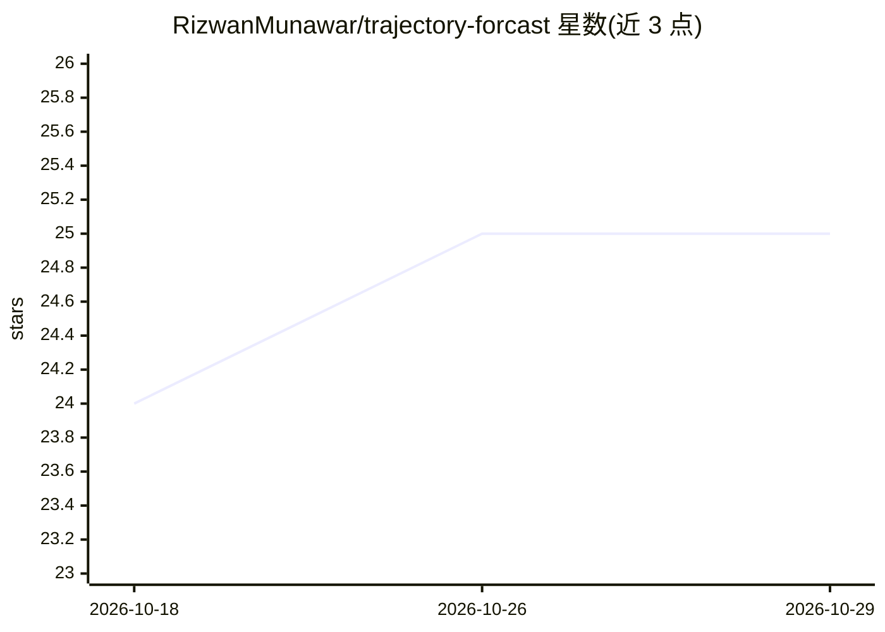

# RizwanMunawar/trajectory-forcast

⭐ 25 · Python · AGPL-3.0 · 推送 2026-10-28 · [GitHub](https://github.com/RizwanMunawar/trajectory-forcast) · [官网](https://rizwanai.com/) · 个人维护

**视频目标跟踪与轨迹预测包：YOLO 检测加卡尔曼预测未来位置**

基于 Ultralytics YOLO 的轻量 Python 包，对视频中的目标进行检测与跟踪，维护运动历史并用加速度感知的卡尔曼滤波预测目标未来轨迹。提供 CLI 与 Python API，任何 Ultralytics 支持的检测模型均可使用；支持 YAML 配置预测步数、最小轨迹点数、短时检测中断保持等参数。预测层用 float32 状态数组和向量化生成以控制每帧开销，终端单独报告预测耗时。

## 筛选速览

| 维度 | 判定 | 备注 |
|---|---|---|
| AI 角色 | `ai-native` | 本体是模型或模型工具 |
| 许可风险 | `viral` | AGPL-3.0 |
| 部署形态 | `library` | 以包/库形式分发 |
| 模型依赖 | — | README 未给出锁定关系 |
| 硬件要求 | — | 无带数字的原话,不猜 |
| 安装摩擦 | `low` | 无编译、无系统依赖或容器化 |
| 成熟度 | — | 结构信号不足 |

## 能力要点

- YOLO 检测→跟踪→卡尔曼滤波→未来轨迹的预测流水线
- 加速度感知运动状态，跟踪速度变化而非固定速度假设
- 短时检测中断（max_gap_frames）内保持运动状态
- CLI 与 Python API 双入口，YAML 可配置

## 适用场景

- 车辆轨迹预测与交通分析
- 行人运动预测
- 机器人与自主系统感知
- 视频监控与运动分析

## 场景标签

`目标检测` `图像视频处理` · 领域:感知与多模态

## 证据(README 行号)

> L12: Trajectory Forecast is a lightweight Python package for real-time **object tracking and trajectory forecasting with
> L101: `YOLO detection → Object tracking → Motion history → Kalman forecasting → Future trajectory`

## 星数曲线

2026-10-18 24 → 2026-10-29 25（+1）

---
*卡片 v1 · prompt 1.4 · 生成 2026-10-27 · 置信度 high · 依据 README sha `5af764010a26` · [字段定义](../../DATASET.md)*
