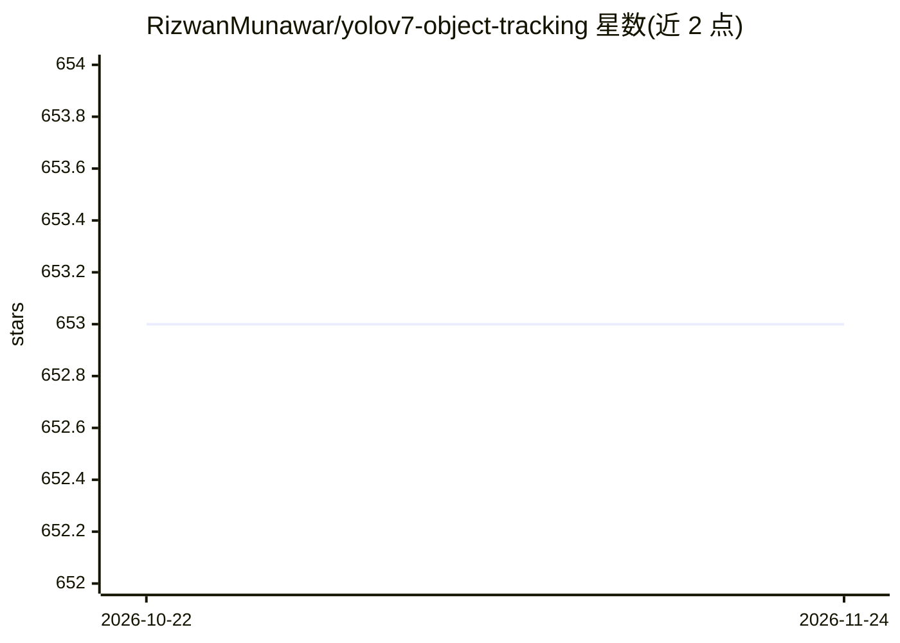

# RizwanMunawar/yolov7-object-tracking

⭐ 653 · Python · AGPL-3.0 · 推送 2026-11-05 · [GitHub](https://github.com/RizwanMunawar/yolov7-object-tracking) · [官网](https://rizwanai.com) · 个人维护

**基于 YOLOv7 与 SORT 的目标检测与跟踪脚本工具**

提供 detect.py 与 detect_and_track.py 脚本，用 YOLOv7 权重做目标检测，并经 SORT 算法为画面中的目标分配跟踪 ID；输入源支持视频文件、文件夹、本机/外接摄像头与 IP 摄像头流，输出带轨迹的可视化结果及轨迹质心、ID、边界框坐标的文本文件。支持 --classes 按类别过滤、彩色轨迹等参数，权重可自动下载。面向需要视频目标检测与跟踪的开发者与研究人员，通过 clone 仓库并 pip 安装依赖运行。

## 筛选速览

| 维度 | 判定 | 备注 |
|---|---|---|
| AI 角色 | `ai-native` | 本体是模型或模型工具 |
| 许可风险 | `viral` | AGPL-3.0 |
| 部署形态 | `library` | 以包/库形式分发 |
| 模型依赖 | — | README 未给出锁定关系 |
| 硬件要求 | — | 无带数字的原话,不猜 |
| 安装摩擦 | `medium` | 含编译或系统依赖之一 |
| 成熟度 | — | 结构信号不足 |

## 能力要点

- detect.py 检测与 detect_and_track.py 检测+SORT 跟踪两种模式
- 支持视频文件、文件夹、webcam、外接摄像头与 IP 摄像头流输入
- 可保存轨迹质心、ID、边界框坐标到 .txt（支持按对象 ID 保存）
- 自动下载预训练 yolov7 权重，README 声明已加入 YOLOv8 权重支持

## 适用场景

- 对已有视频跑检测并给目标分配跟踪 ID
- 接摄像头或 IP 摄像头流做实时检测跟踪
- 导出轨迹 ID 与边界框坐标做后续分析
- 按类别（如 person）过滤跟踪结果

## 场景标签

`目标检测` · 领域:感知与多模态

## 证据(README 行号)

> L1: ## YOLOv7 Object Tracking 🚀
> L61:  - **Detection only**:
> L69:  - **Object tracking**:

## 星数曲线

2026-10-22 653 → 2026-11-24 653（+0）

---
*卡片 v1 · prompt 1.4 · 生成 2026-11-24 · 置信度 high · 依据 README sha `bb9f61caed6e` · [字段定义](../../DATASET.md)*
