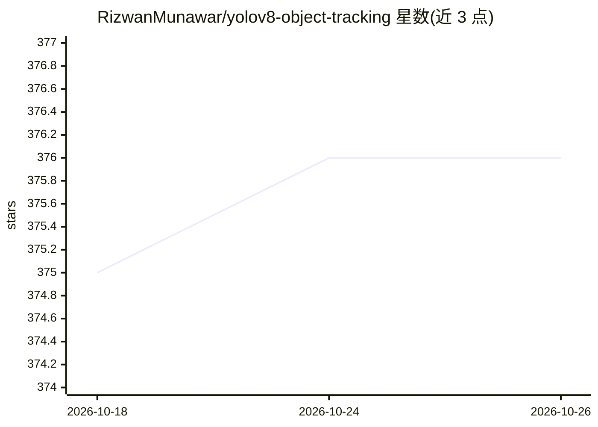

# RizwanMunawar/yolov8-object-tracking

⭐ 376 · Python · AGPL-3.0 · 推送 2026-01-13 · [GitHub](https://github.com/RizwanMunawar/yolov8-object-tracking) · 个人维护

**基于 YOLOv8 的视频目标检测与跟踪示例工程**

个人维护的计算机视觉示例仓库：使用 Ultralytics YOLOv8 权重对视频文件或摄像头画面执行目标检测，并结合跟踪算法输出带跟踪 ID 的结果视频。使用方式为克隆源码后安装 ultralytics==8.0.0 依赖，通过命令行指定模型权重与视频源运行脚本，输出保存于 runs/detect/train 目录。README 声明仅兼容 ultralytics==8.0.0，并建议改用最新版 Ultralytics 官方代码库。

## 筛选速览

| 维度 | 判定 | 备注 |
|---|---|---|
| AI 角色 | `ai-native` | 本体是模型或模型工具 |
| 许可风险 | `viral` | AGPL-3.0 |
| 部署形态 | `library` | 以包/库形式分发 |
| 模型依赖 | — | README 未给出锁定关系 |
| 硬件要求 | — | 无带数字的原话,不猜 |
| 安装摩擦 | `low` | 无编译、无系统依赖或容器化 |
| 成熟度 | — | 结构信号不足 |

## 能力要点

- 命令行指定模型权重与视频源执行检测与跟踪
- 输出结果保存至 runs/detect/train
- README 声明仅兼容 ultralytics==8.0.0

## 适用场景

- 对视频文件运行 YOLOv8 目标检测与跟踪
- 学习 Ultralytics 检测+跟踪脚本的使用方式
- 作为自定义目标跟踪任务的起点代码

## 场景标签

`目标检测` `教程课程` · 领域:学习与行业

## 证据(README 行号)

> L3: This is compatible only with `ultralytics==8.0.0`. However, I highly recommend using the latest version of the Ultra
> L27: #video file
> L28: python yolo\v8\detect\detect_and_trk.py model=yolov8s.pt source="test.mp4" show=True

## 星数曲线

2026-10-18 375 → 2026-10-26 376（+1）

---
*卡片 v1 · prompt 1.4 · 生成 2026-10-21 · 置信度 mid · 依据 README sha `7a694ae5fe5a` · [字段定义](../../DATASET.md)*
