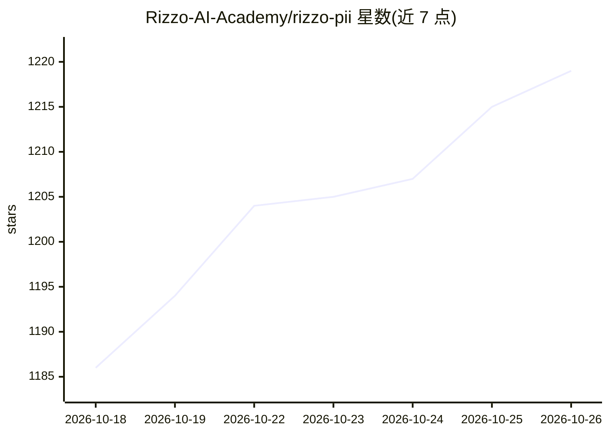

# Rizzo-AI-Academy/rizzo-pii

⭐ 1,219 · Python · MIT · 推送 2026-10-23 · [GitHub](https://github.com/Rizzo-AI-Academy/rizzo-pii) · [官网](https://rizzo-ai-academy.github.io/rizzo-pii/) · 组织维护

**本地可逆 PII 匿名化工具：发给 LLM 前遮蔽意大利法律文本中的个人数据**

面向受 GDPR 约束的意大利法律行业（律所、会计师、公证人）的本地优先匿名化应用：内置约 0.3B 参数的 mmBERT/ModernBERT token 分类模型，在 CPU 上检测 22 类个人数据实体（含 codice fiscale、partita IVA、dati catastali 等意大利法律标识符），用类型化占位符替换并生成留在本地磁盘的可逆映射字典；匿名化文本发送给云端大模型，回答在本地还原真实值。提供 Windows 安装包、macOS（Apple Silicon）与 Linux AppImage。限制：意大利语优先（另支持 7 种语言），URL 仅由正则处理。

## 筛选速览

| 维度 | 判定 | 备注 |
|---|---|---|
| AI 角色 | `ai-native` | 本体是模型或模型工具 |
| 许可风险 | `permissive` | MIT |
| 部署形态 | `desktop` | 安装包/桌面程序 |
| 模型依赖 | — | README 未给出锁定关系 |
| 硬件要求 | `cpu-ok` | |
| 安装摩擦 | `low` | 无编译、无系统依赖或容器化 |
| 成熟度 | — | 结构信号不足 |

## 能力要点

- 22 类 PII 实体的 BIO 标注，含 5 类意大利法律标识符（CF/PIVA/CATASTO/DOCID/PROVINCE）
- 占位符替换 + 本地可逆字典，回答回传后本地还原真实值
- 约 0.3B 参数、CPU 运行、约 0.5 GB 内存，无需 API key，离线运行
- IBAN mod-97、Luhn、CF/PIVA 官方算法校验和验证

## 适用场景

- 把合同等法律文件匿名化后再发给 ChatGPT/Claude/Gemini 处理
- 律所、会计师事务所满足 GDPR 数据最小化要求仍使用云端模型
- 对意大利语敏感文书做可逆假名化处理

## 场景标签

 · 领域:隐私/NLP 法律科技

## 证据(README 行号)

> L27: **`rizzo-pii:0.3B`** is a lightweight, CPU-friendly, **Italian-first** token-classification
> L33: 🔒 **anonymize locally** → 🏷️ **placeholder + reversible local dictionary** → ☁️ **frontier LLM** → 🔓 **restore loca
> L35: It is built for law firms, accountants, notaries and anyone bound by the **GDPR** who wants to

## 星数曲线

2026-10-18 1,186 → 2026-10-26 1,219（+33）

---
*卡片 v1 · prompt 1.4 · 生成 2026-10-21 · 置信度 high · 依据 README sha `303afe8e23a2` · [字段定义](../../DATASET.md)*
